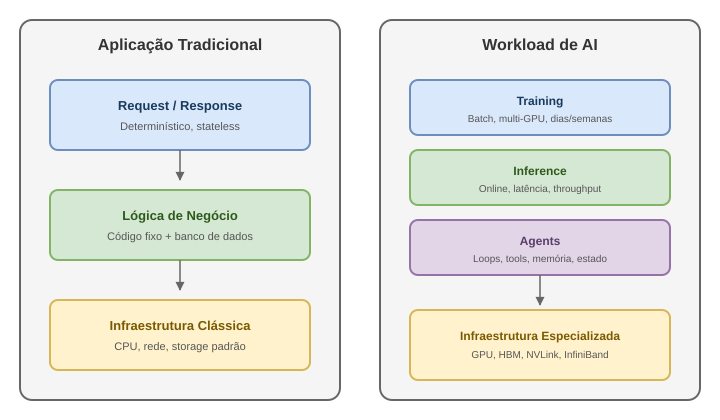
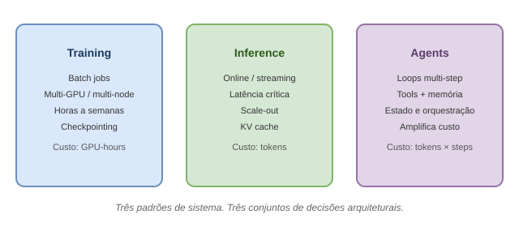

# Chapter 1 — Why AI is Different
## Mental Models for Architects

The best AI system I have ever seen was not designed by a data scientist. It was designed by an architect who understood that AI is not a regular application.

This handbook is the sibling project of [AI for Infra Pros](https://www.ai4infra.com/). While that material focuses on operations, deployment and troubleshooting, this one focuses on architecture decisions.

---

## The meeting that changes the game

You are on a call with an advanced digital-native client. They talk about continuous batching, PagedAttention, disaggregated serving, agent loops and open weights as if they were everyday terms. On the other side of the table, the traditional infrastructure team still thinks in terms of “spin up an API and put a load balancer in front of it.”

That disconnect is not a lack of technical knowledge. It is a lack of mental model.

This chapter builds the mental model an architect needs to talk at the same level as those clients without becoming an ML developer.

---

## What changes when the system is AI

In a traditional application, the architect designs a relatively predictable flow: request arrives, business logic processes it, response goes out. State lives in the database. Compute is CPU. Network is standard Ethernet. Cost is relatively linear with load.

In AI, three things break that model:

1. The “code” is not deterministic in the same way. The model is a static artifact (weights) that produces probabilistic outputs.
2. The dominant compute is no longer CPU. It becomes GPU with specialized memory (HBM), high-bandwidth interconnect (NVLink, InfiniBand) and collective communication patterns (all-reduce).
3. There are three fundamentally different modes of operation, and each one requires a distinct architecture.

---

## The three fundamental modes

| Mode       | Nature                    | Duration         | State                   | Main bottleneck       | Cost model           |
|------------|---------------------------|------------------|-------------------------|-----------------------|----------------------|
| Training   | Batch, offline            | Hours to weeks   | Checkpoints + gradients | Multi-GPU communication | GPU-hours            |
| Inference  | Online, interactive       | Milliseconds     | KV cache (temporary)    | Latency + throughput  | Tokens               |
| Agents     | Multi-step loops          | Seconds to min.  | Memory + tools + state  | Token amplification   | Tokens × steps        |

Golden rule: never design a “generic AI” architecture. First ask which mode we are optimizing for.

---

## Why this matters for the architect

The architect does not need to know how to write the training loop or the attention kernel. He needs to know:

- When a 200 ms latency requirement makes disaggregated serving necessary.
- Why an agent with 5 steps can cost 10–20× more than a simple inference call.
- Why self-hosted open weights only make sense above a certain volume or under data residency constraints.
- How to map those requirements to Azure decisions (Foundry, ND-series, AKS + vLLM, private endpoints).

These are system design decisions. They define the shape of the architecture long before any code is written.

For the operational side (how to operate the cluster, GPU troubleshooting, IaC), see [AI for Infra Pros](https://www.ai4infra.com/).

---

## Essential mental models

| AI Concept           | Architectural equivalent          | Why the mapping helps                       |
|----------------------|-----------------------------------|---------------------------------------------|
| Model (weights)      | Versioned artifact               | Has lifecycle, storage, and can be replaced |
| Training             | Large-scale batch job             | Fault-tolerant, needs checkpointing         |
| Inference            | High-performance API              | Latency SLA, scale-out, observability       |
| KV cache             | Specialized session cache         | Consumes memory, affects throughput         |
| Agent loop           | Workflow with state and side-effects | Amplifies cost and failure risk          |
| Open weights         | Binary you control                | Enables self-host, fine-tune and quantization |
| RAG                  | Retrieval + generation            | Adds a data layer to the critical path      |

---

## When to use / when not to use

| Situation                             | Recommended approach               | Why                                           |
|--------------------------------------|------------------------------------|-----------------------------------------------|
| Low volume, generic task              | Closed API (Foundry / Azure OpenAI) | Lower operational overhead                    |
| Data cannot leave the perimeter      | Self-hosted open weights           | Data residency / compliance                   |
| Extremely low latency                | Optimized inference (disaggregated)| Prefill and decode have different requirements |
| Multi-step process with tools        | Agent with controlled orchestration | But measure the cost amplification           |
| Training a large model               | Multi-node cluster + InfiniBand    | Communication is the bottleneck               |

---

## Checklist

- [ ] What are the three fundamental modes of AI and how do they differ in state, duration and cost?
- [ ] Why does an inference architecture not serve training (and vice-versa)?
- [ ] What is cost amplification in agentic systems?
- [ ] When do open weights stop being “cheaper” and become an architecture decision?
- [ ] How would you explain the difference between a traditional system and an AI workload to a non-technical stakeholder?

---

Next: Training vs Inference vs Agents. The system trade-offs that change the architecture decision.
