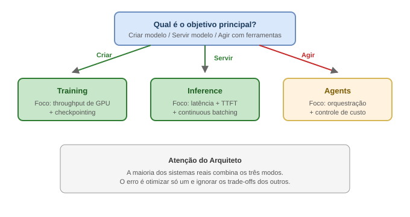

# Capítulo 2 — Training vs Inference vs Agents
## Trade-offs de Sistema

> “Se você desenhar a arquitetura pensando só em inference, o training vai doer. Se desenhar só para training, o agent vai te falir.”

---

## O erro mais comum do arquiteto

Muitos arquitetos tratam AI como “uma aplicação que usa GPU”. Isso leva a arquiteturas que funcionam razoavelmente para um modo e quebram nos outros dois.

Este capítulo aprofunda os trade-offs reais de system design entre os três modos. O objetivo não é ensinar a implementar, mas dar a você a linguagem e os frameworks para tomar decisões conscientes — e defender essas decisões com clientes avançados.

---

## Visão geral dos trade-offs

| Dimensão          | Training                          | Inference                              | Agents                                   |
|-------------------|-----------------------------------|----------------------------------------|------------------------------------------|
| **Padrão de carga**   | Batch, longo, previsível            | Online, bursty, latência-sensível        | Multi-step, variável, side-effects         |
| **Compute**       | Alto utilization, collective ops  | Prefill (compute-bound) + Decode (memory-bound) | Múltiplas chamadas de inference           |
| **Networking**    | InfiniBand / NVLink críticos        | Baixa latência, alto throughput         | Chamadas a tools + APIs externas         |
| **Estado**        | Checkpoints + optimizer state     | KV cache (sessão)                       | Memória de longo prazo + contexto        |
| **Tolerância a falha** | Checkpoint e resume obrigatórios   | Retry e fallback de modelo             | Orquestração + human-in-the-loop        |
| **Modelo de custo**  | GPU-hours                         | Custo por milhão de tokens               | Tokens × número de steps                  |
| **Escala**        | Scale-up + scale-out              | Principalmente scale-out               | Orquestração e isolamento                |

---

## Training: o modo de throughput

Training é um job de batch em larga escala. O objetivo é maximizar utilization de GPU durante horas ou semanas.

**O que o arquiteto precisa decidir:**
- Quantos GPUs por nó e qual interconexão (NVLink vs InfiniBand)
- Estratégia de paralelismo (data, tensor, pipeline, expert)
- Frequência e local de checkpoints
- Como lidar com preempção ou falha de nó

**Impacto em infraestrutura:**
- Rede de alta banda e baixa latência deixa de ser opcional
- Storage precisa suportar escrita massiva de checkpoints
- O custo dominante é GPU-hour, não requisição

---

## Inference: o modo de latência e throughput

Inference é um serviço online. O arquiteto precisa equilibrar **Time to First Token (TTFT)** e **throughput** (tokens por segundo).

**Trade-offs críticos:**
- **Prefill** é compute-bound. **Decode** é memory-bound (KV cache).
- Continuous batching aumenta throughput, mas pode aumentar latência.
- Disaggregated serving (prefill e decode em pools separados) melhora ambos, mas adiciona complexidade de rede.

**O que o arquiteto decide:**
- Qual engine (vLLM, SGLang, Azure OpenAI, Foundry)
- Quantização (FP8, INT8) vs qualidade
- Se vale a pena disaggregated serving
- Estratégia de fallback e rate limiting

---

## Agents: o modo que amplifica tudo

Um agent não é “uma inference mais inteligente”. É um loop que faz múltiplas chamadas de inference, chama tools e mantém estado.

**Efeito de amplificação:**
- 1 chamada de inference → 1× custo
- Agent com 8 steps + 3 tools → facilmente 10–20× o custo e a latência

**Decisões de arquiteto:**
- Onde colocar a orquestração (Foundry, LangGraph, custom)
- Quanto de memória de longo prazo é necessário
- Quando colocar human-in-the-loop
- Como isolar tools para reduzir blast radius

---

## Framework de decisão

### Perguntas que o arquiteto deve fazer

1. **O sistema precisa criar modelos novos ou só servir modelos existentes?**
2. **A latência de resposta é crítica (< 1s) ou o throughput é mais importante?**
3. **Existem side-effects (escrever em sistemas, chamar APIs externas)?**
4. **Qual é o orçamento de custo por interação aceitável?**
5. **Os dados podem sair do perímetro ou precisamos de self-hosted?**

---

## Quando usar / quando não usar

| Necessidade                          | Foco principal     | Evitar                              |
|--------------------------------------|--------------------|-------------------------------------|
| Treinar ou fine-tune modelo grande   | Training           | Tentar fazer no mesmo cluster de inference |
| API de chat com SLA de latência       | Inference          | Agent sem controle de steps         |
| Processo multi-step com tools        | Agents             | Agent sem observabilidade de custo  |
| Mistura de treinamento e serviço      | Separar clusters   | Um cluster “faz tudo”               |
| Volume baixo, rápido time-to-market  | Inference gerenciada | Self-hosted complexo no início     |

---

## Checklist do capítulo

- [ ] Consigo explicar a diferença de networking entre training e inference?
- [ ] Entendo por que disaggregated serving existe?
- [ ] Sei estimar a amplificação de custo de um agent?
- [ ] Tenho um framework para decidir se o sistema deve ser training-first, inference-first ou agent-first?
- [ ] Consigo mapear esses trade-offs para decisões de Azure (ND-series, AKS, Foundry)?

---

## O que vem a seguir

No Capítulo 3 vamos descer um nível: **Compute, memória e conectividade** (HBM, NVLink, InfiniBand, scale-up vs scale-out). É o capítulo que conecta os trade-offs de sistema com as decisões concretas de hardware e rede.

Quer ajustes neste capítulo (mais profundidade em algum trade-off, mais exemplos Azure, diagramas diferentes) ou seguimos para o Capítulo 3?
