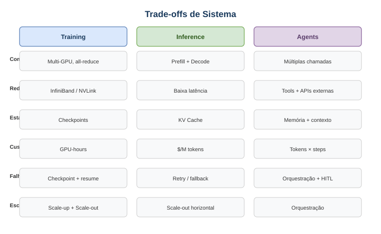

# Chapter 2 — Training vs Inference vs Agents

If you design the architecture thinking only about inference, training will hurt. If you design only for training, the agent will bankrupt you.

---

## The most common mistake

Treating AI as “an application that uses GPUs.” This produces architectures that work reasonably for one mode and break in the other two.

---

## System trade-offs

| Dimension         | Training                          | Inference                              | Agents                                   |
|-------------------|-----------------------------------|----------------------------------------|------------------------------------------|
| Load pattern      | Batch, long, predictable          | Online, bursty, latency-sensitive      | Multi-step, variable, side-effects       |
| Compute           | High utilization, collective ops  | Prefill (compute-bound) + Decode (memory-bound) | Multiple inference calls                 |
| Networking        | InfiniBand / NVLink critical      | Low latency, high throughput           | Calls to tools + external APIs           |
| State             | Checkpoints + optimizer state     | KV cache (session)                     | Long-term memory + context               |
| Fault tolerance   | Checkpoint and resume mandatory   | Retry and model fallback               | Orchestration + human-in-the-loop        |
| Cost model        | GPU-hours                         | Cost per million tokens                | Tokens × number of steps                |
| Scale             | Scale-up + scale-out              | Mainly scale-out                       | Orchestration and isolation              |

---

## Training

Large-scale batch job. The goal is to maximize utilization for hours or weeks.

The architect decides: number of GPUs per node, interconnect (NVLink vs InfiniBand), parallelism strategy and checkpoint frequency. High-bandwidth network stops being optional. Storage must handle massive writes. The dominant cost is GPU-hour.

---

## Inference

Online service. Balance TTFT and throughput.

Prefill is compute-bound. Decode is memory-bound. Continuous batching increases throughput and can increase latency. Disaggregated serving improves both and adds network complexity. The architect decides the engine, quantization and whether the complexity of disaggregated serving is worth the gain.

---

## Agents

Not “smarter inference.” It is a loop that makes multiple calls, invokes tools and maintains state.

One inference call costs 1×. An agent with 8 steps and 3 tools easily costs 10–20× in tokens and latency. The architect decides where to orchestrate, how much long-term memory is needed, when to put human-in-the-loop and how to isolate tools.

---

## Decision framework

1. Does the system need to create new models or only serve existing ones?
2. Is response latency critical or is throughput more important?
3. Are there side-effects?
4. What is the acceptable cost budget per interaction?
5. Can the data leave the perimeter?

---

## When to use / when not to use

| Need                                 | Primary focus      | What breaks if mixed wrong               |
|--------------------------------------|--------------------|------------------------------------------|
| Train or fine-tune a large model     | Training           | Same inference cluster: long jobs compete with SLA |
| Chat API with latency SLA            | Inference          | Agent without step control: cost and latency explode |
| Multi-step process with tools        | Agents             | Without step observability: does not know why cost rose |
| Mix of training and serving          | Separate clusters  | One “does everything” cluster: neither is good |
| Low volume, fast time-to-market      | Managed inference  | Complex self-hosted at the start: operation without return |

---

## Checklist

- [ ] Can I explain the networking difference between training and inference?
- [ ] Do I understand why disaggregated serving exists?
- [ ] Can I estimate the cost amplification of an agent?
- [ ] Do I have a framework to decide whether the system should be training-first, inference-first or agent-first?
- [ ] Can I map these trade-offs to Azure decisions?

---

Next: Compute, memory and connectivity. Where system trade-offs meet HBM, NVLink and InfiniBand.
