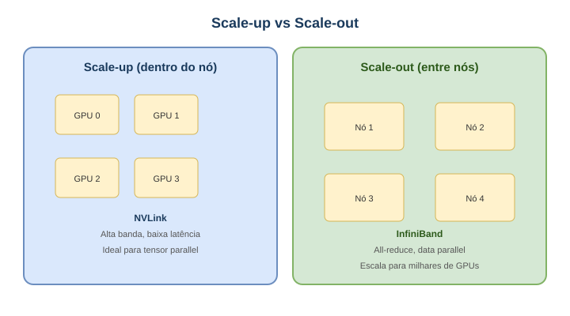

# Chapter 3 — Compute, Memory and Connectivity
## HBM, NVLink, InfiniBand and scale decisions

> “Does the model fit in HBM? That is the first question an AI architect needs to answer.”

---

## Why this chapter exists

In previous chapters we established the three modes and their system trade-offs. Now we go down to the hardware and interconnect level — the place where architecture decisions become concrete.

The architect does not need to know the detail of the attention kernel. He needs to understand:

- Why HBM is the scarcest resource
- When scale-up (NVLink) is enough and when scale-out (InfiniBand) is required
- How those choices affect cost, latency and resilience

---

## The memory hierarchy that matters

For the architect, memory in AI comes down to a simple rule:

**What does not fit in HBM does not exist for the model during inference.**

| Layer           | Typical capacity      | Speed          | What lives here                     |
|-----------------|-----------------------|----------------|-------------------------------------|
| Registers/SM    | Very small            | Extremely high | Temporary computation data          |
| L2 Cache        | Tens of MB            | Very high      | Data reuse                          |
| **HBM**         | 80–192 GB per GPU    | High           | Weights + KV cache + activations    |
| Host Memory     | TBs                   | Low            | Offloading (rarely used)            |

**Practical impact:**
- KV cache consumes HBM linearly with context size and batch.
- This limits how many simultaneous users one GPU can serve.
- It is the reason techniques like PagedAttention and quantization exist.

---

## Scale-up vs Scale-out

| Aspect               | Scale-up (NVLink)                  | Scale-out (InfiniBand / Ethernet)     |
|----------------------|------------------------------------|---------------------------------------|
| **Where it happens** | Inside the node (8 GPUs)          | Between nodes                         |
| **Bandwidth**        | Extremely high (900 GB/s+)        | High, but lower (400–800 Gb/s)      |
| **Latency**          | Very low                          | Higher                                |
| **Best for**         | Tensor Parallel, large models     | Data Parallel, large clusters         |
| **Limit**            | Number of GPUs in the node        | Almost unlimited                      |
| **Relative cost**    | Included in the node              | Dedicated network infrastructure      |

**Golden rule:**
- Models that fit in 1–8 GPUs → prioritize scale-up (NVLink).
- Larger models or training at scale → scale-out with InfiniBand.

---

## Architect decisions

### 1. How many GPUs does the model fit in?
- If it fits in 1 GPU (with quantization) → simple inference, lower complexity.
- If it needs tensor parallel → requires NVLink or equivalent.
- If it needs pipeline + data parallel → requires InfiniBand.

### 2. What interconnect do I need?
| Scenario                         | Recommended interconnect     |
|----------------------------------|----------------------------|
| Medium model inference           | NVLink inside the node      |
| Large model training             | InfiniBand                 |
| Scaled inference cluster         | High-performance Ethernet or InfiniBand |
| Multi-agent with tools           | Normal network (the bottleneck is not the GPU) |

### 3. Impact on Azure
- **ND-series** (H100/H200/B200) already come with NVLink and InfiniBand options.
- The SKU choice defines the scale-up ceiling.
- For scale-out, the decision is whether you use AKS, CycleCloud/Slurm or managed Foundry.

---

## When to use / when not to use

| Situation                             | Recommendation                        | Reason                                      |
|--------------------------------------|---------------------------------------|---------------------------------------------|
| Model fits in 1 GPU                  | Simple scale-up                       | Lower complexity and cost                   |
| Large model, inference               | Tensor parallel + NVLink              | Avoids network overhead                     |
| Training model > 70B                 | Scale-out + InfiniBand                | Collective communication is the bottleneck  |
| Multi-node inference cluster         | Scale-out                             | Horizontal throughput                       |
| Limited network budget               | Avoid InfiniBand if possible          | High-performance Ethernet may be enough     |

---

## Chapter checklist

- [ ] Do I understand why HBM is the scarcest resource in inference?
- [ ] Can I explain the difference between NVLink and InfiniBand to a stakeholder?
- [ ] Do I know when a model requires tensor parallel?
- [ ] Can I map these decisions to Azure SKUs (ND-series)?
- [ ] Do I understand the impact of context size on HBM consumption?

---

## What comes next

In Chapter 4 we enter the heart of inference at scale: **Prefill vs Decode, Continuous Batching, PagedAttention and Disaggregated Serving**. It is the chapter that turns hardware knowledge into service architecture decisions.
