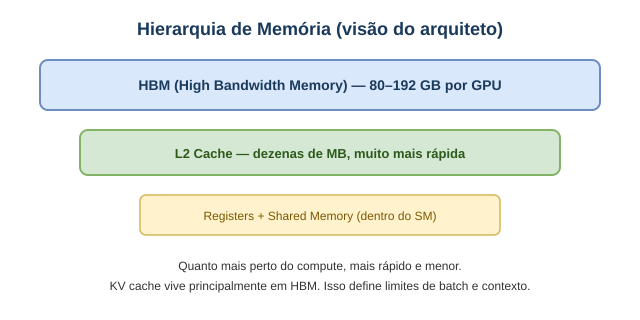

# Capítulo 3 — Compute, Memória e Conectividade
## HBM, NVLink, InfiniBand e as decisões de escala

> “O modelo cabe na HBM? Essa é a primeira pergunta que um arquiteto de AI precisa responder.”

---

## Por que este capítulo existe

Nos capítulos anteriores estabelecemos os três modos e seus trade-offs de sistema. Agora descemos para o nível de hardware e interconexão — o lugar onde as decisões de arquitetura se tornam concretas.

O arquiteto não precisa saber o detalhe do kernel de attention. Ele precisa entender:

- Por que HBM é o recurso mais escasso
- Quando scale-up (NVLink) é suficiente e quando precisa de scale-out (InfiniBand)
- Como essas escolhas afetam custo, latência e resiliência

---

## A hierarquia de memória que importa

Para o arquiteto, a memória em AI se resume a uma regra simples:

**O que não cabe na HBM não existe para o modelo durante a inference.**

| Camada          | Capacidade típica     | Velocidade     | O que vive aqui                     |
|-----------------|---------------------|----------------|-------------------------------------|
| Registers/SM    | Muito pequena       | Extremamente alta | Dados temporários de computação   |
| L2 Cache        | Dezenas de MB       | Muito alta     | Reuso de dados                      |
| **HBM**         | 80–192 GB por GPU    | Alta           | Pesos + KV cache + ativações      |
| Host Memory     | TBs                 | Baixa          | Offloading (raramente usado)        |

**Impacto prático:**
- KV cache consome HBM linearmente com o tamanho do contexto e o batch.
- Isso limita quantos usuários simultâneos um GPU consegue atender.
- É o motivo pelo qual técnicas como PagedAttention e quantização existem.

---

## Scale-up vs Scale-out

| Aspecto              | Scale-up (NVLink)                  | Scale-out (InfiniBand / Ethernet)     |
|----------------------|------------------------------------|---------------------------------------|
| **Onde acontece**    | Dentro do nó (8 GPUs)             | Entre nós                              |
| **Banda**            | Extremamente alta (900 GB/s+)      | Alta, mas menor (400–800 Gb/s)        |
| **Latência**         | Muito baixa                        | Mais alta                             |
| **Melhor para**      | Tensor Parallel, grandes modelos   | Data Parallel, clusters grandes       |
| **Limite**           | Número de GPUs no nó               | Quase ilimitado                       |
| **Custo relativo**   | Incluso no nó                     | Infraestrutura de rede dedicada       |

**Regra de ouro:**
- Modelos que cabem em 1–8 GPUs → priorize scale-up (NVLink).
- Modelos maiores ou training em escala → scale-out com InfiniBand.

---

## Decisões de arquiteto

### 1. O modelo cabe em quantos GPUs?
- Se cabe em 1 GPU (com quantização) → inference simples, menor complexidade.
- Se precisa de tensor parallel → exige NVLink ou equivalente.
- Se precisa de pipeline + data parallel → exige InfiniBand.

### 2. Qual interconexão eu preciso?
| Cenário                          | Interconexão recomendada     |
|----------------------------------|----------------------------|
| Inference de modelo médio        | NVLink no nó                |
| Training de modelo grande        | InfiniBand                 |
| Cluster de inference em escala   | Ethernet de alta performance ou InfiniBand |
| Multi-agent com tools            | Rede normal (o gargalo não é a GPU) |

### 3. Impacto em Azure
- **ND-series** (H100/H200/B200) já vêm com NVLink e opções de InfiniBand.
- A escolha do SKU define o teto de scale-up.
- Para scale-out, a decisão é se você usa AKS, CycleCloud/Slurm ou Foundry gerenciado.

---

## Quando usar / quando não usar

| Situação                              | Recomendação                          | Motivo                                      |
|--------------------------------------|---------------------------------------|---------------------------------------------|
| Modelo cabe em 1 GPU                 | Scale-up simples                      | Menor complexidade e custo                  |
| Modelo grande, inference             | Tensor parallel + NVLink              | Evita overhead de rede                      |
| Training de modelo > 70B             | Scale-out + InfiniBand                | Comunicação coletiva é o gargalo         |
| Cluster de inference multi-nó       | Scale-out                             | Throughput horizontal                       |
| Orçamento limitado de rede           | Evitar InfiniBand se possível         | Ethernet de alta performance pode bastar    |

---

## Checklist do capítulo

- [ ] Entendo por que HBM é o recurso mais escasso em inference?
- [ ] Consigo explicar a diferença entre NVLink e InfiniBand para um stakeholder?
- [ ] Sei quando um modelo exige tensor parallel?
- [ ] Consigo mapear essas decisões para SKUs do Azure (ND-series)?
- [ ] Entendo o impacto do tamanho de contexto no consumo de HBM?

---

## O que vem a seguir

No Capítulo 4 entramos no coração da inference em escala: **Prefill vs Decode, Continuous Batching, PagedAttention e Disaggregated Serving**. É o capítulo que transforma o conhecimento de hardware em decisões de arquitetura de serviço.

Quer ajustes neste capítulo ou seguimos para o Capítulo 4?
