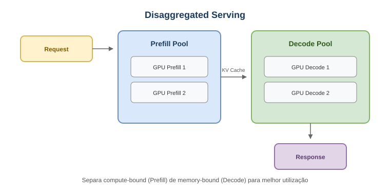

# Capítulo 4 — Inference em Escala
## Prefill, Decode, Continuous Batching e Disaggregated Serving

> “O segredo de uma boa arquitetura de inference não é ter mais GPU. É não desperdiçar a GPU que você já tem.”

---

## O problema que o arquiteto precisa resolver

Inference de LLM não é um request-response normal. Ela tem duas fases com requisitos completamente diferentes. Ignorar essa diferença leva a clusters caros e subutilizados.

Este capítulo explica os padrões modernos de inference em escala e as decisões que o arquiteto precisa tomar.

---

## Prefill vs Decode

| Fase       | O que faz                          | Gargalo          | Impacto principal     |
|------------|------------------------------------|------------------|-----------------------|
| **Prefill**    | Processa o prompt inteiro de uma vez | Compute (FLOPs)  | Time to First Token (TTFT) |
| **Decode**     | Gera um token por vez              | Memória (KV cache) | Throughput (tokens/s) |

**Consequência para o arquiteto:**
- Prompts longos sobrecarregam o Prefill.
- Gerações longas sobrecarregam o Decode (e o HBM).
- Um único pool de GPU raramente otimiza as duas fases ao mesmo tempo.

---

## Continuous Batching

Em vez de esperar um batch completo, o sistema adiciona e remove requests dinamicamente.

**Benefício:** maior utilization de GPU.  
**Trade-off:** pode aumentar a latência de requests individuais se o batch ficar muito grande.

**Decisão do arquiteto:**
- Continuous batching é quase sempre desejável em produção.
- O limite é o quanto de latência adicional você aceita.

---

## PagedAttention

Técnica que trata o KV cache como páginas de memória (similar a virtual memory).

**Por que importa:**
- Reduz fragmentação de HBM.
- Permite batches maiores e contextos mais longos no mesmo GPU.
- É a base de engines modernas como vLLM.

**Impacto arquitetural:** engines que implementam PagedAttention (vLLM, SGLang) conseguem servir mais usuários por GPU do que implementações ingênuas.

---

## Disaggregated Serving

Separa os GPUs em dois pools:
- **Prefill pool**: otimizado para compute
- **Decode pool**: otimizado para memória e throughput

**Quando vale a pena:**
- Cargas com grande variação de tamanho de prompt
- Necessidade de otimizar TTFT e throughput ao mesmo tempo
- Clusters grandes (dezenas ou centenas de GPUs)

**Custo da complexidade:**
- Precisa transferir o KV cache entre pools
- Exige orquestração mais sofisticada
- Nem sempre compensa em clusters pequenos

---

## Speculative Decoding

Usa um modelo menor e mais rápido para “adivinhar” vários tokens, que depois são verificados pelo modelo grande.

**Trade-off:**
- Pode aumentar o throughput em 1.5–2.5×
- Adiciona complexidade e latência no caminho crítico
- Funciona melhor em certos tipos de geração

**Decisão do arquiteto:** use quando o throughput é o gargalo e você tem capacidade de operar dois modelos.

---

## Framework de decisão para o arquiteto

| Prioridade                  | Padrão recomendado              | Complexidade |
|-----------------------------|----------------------------------|--------------|
| Menor TTFT                  | Prefill otimizado + batch pequeno | Média       |
| Maior throughput            | Continuous batching + PagedAttention | Baixa-Média |
| Ambos (TTFT + throughput)   | Disaggregated Serving            | Alta         |
| Custo por token             | Quantização + batching agressivo | Média       |
| Simplicidade operacional    | Engine gerenciada (Foundry)      | Baixa        |

---

## Quando usar / quando não usar

| Situação                              | Recomendação                          |
|--------------------------------------|---------------------------------------|
| Cluster pequeno (< 8 GPUs)           | Continuous batching + PagedAttention  |
| Cluster grande + SLA agressivo de TTFT | Disaggregated Serving                 |
| Volume baixo                         | Serviço gerenciado                    |
| Necessidade de máximo throughput     | Speculative decoding + batching       |
| Equipe sem experiência em inference   | Evitar disaggregated no início         |

---

## Checklist do capítulo

- [ ] Consigo explicar a diferença entre Prefill e Decode para um stakeholder?
- [ ] Entendo por que continuous batching aumenta utilization?
- [ ] Sei quando disaggregated serving vale a complexidade?
- [ ] Consigo mapear esses padrões para engines (vLLM, SGLang, Foundry)?
- [ ] Entendo o impacto dessas escolhas no custo por milhão de tokens?

---

## O que vem a seguir

No Capítulo 5 vamos falar de **RAG e Retrieval Architectures**. Como o arquiteto desenha sistemas que combinam retrieval de dados com geração, e quais são os trade-offs de latência, frescor de dados e custo.

Quer ajustes neste capítulo ou seguimos para o Capítulo 5?
