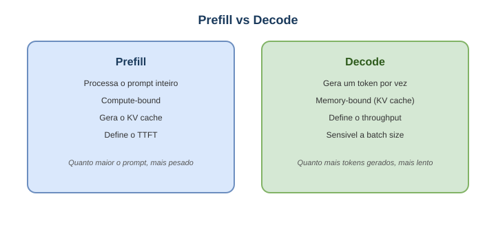

# Capítulo 4 — Inference em Escala

O segredo de uma boa arquitetura de inference não é ter mais GPU. É não desperdiçar a GPU que você já tem.

Para a parte operacional de como rodar e troubleshootar esses engines em produção, veja o [AI for Infra Pros](https://www.ai4infra.com/).

---

## O problema que o arquiteto precisa resolver

Inference de LLM não é um request-response normal. Ela tem duas fases com requisitos completamente diferentes. Ignorar essa diferença leva a clusters caros e subutilizados.

---

## Prefill vs Decode

| Fase       | O que faz                          | Gargalo          | Impacto principal     |
|------------|------------------------------------|------------------|-----------------------|
| Prefill    | Processa o prompt inteiro de uma vez | Compute (FLOPs)  | Time to First Token (TTFT) |
| Decode     | Gera um token por vez              | Memória (KV cache) | Throughput (tokens/s) |

Prompts longos sobrecarregam o Prefill. Gerações longas sobrecarregam o Decode e o HBM. Um único pool de GPU raramente otimiza as duas fases ao mesmo tempo.

---

## Continuous Batching

Em vez de esperar um batch completo, o sistema adiciona e remove requests dinamicamente.

Benefício: maior utilization de GPU. Trade-off: pode aumentar a latência de requests individuais se o batch ficar muito grande.

Continuous batching é quase sempre desejável em produção. O limite é o quanto de latência adicional você aceita.

---

## PagedAttention

Técnica que trata o KV cache como páginas de memória (similar a virtual memory). Reduz fragmentação de HBM e permite batches maiores e contextos mais longos no mesmo GPU. É a base de engines modernas como vLLM.

Engines que implementam PagedAttention (vLLM, SGLang) conseguem servir mais usuários por GPU do que implementações ingênuas.

---

## Disaggregated Serving

Separa os GPUs em dois pools: Prefill otimizado para compute e Decode otimizado para memória e throughput.

Vale a pena quando há grande variação de tamanho de prompt, necessidade de otimizar TTFT e throughput ao mesmo tempo, e clusters grandes (dezenas ou centenas de GPUs).

Custo da complexidade: precisa transferir o KV cache entre pools e exige orquestração mais sofisticada. Nem sempre compensa em clusters pequenos.

---

## Speculative Decoding

Usa um modelo menor e mais rápido para adivinhar vários tokens, que depois são verificados pelo modelo grande. Pode aumentar o throughput em 1,5–2,5×. Adiciona complexidade e latência no caminho crítico. Funciona melhor em certos tipos de geração.

Use quando o throughput é o gargalo e você tem capacidade de operar dois modelos.

---

## Framework de decisão

| Prioridade                  | Padrão recomendado              | Complexidade |
|-----------------------------|----------------------------------|--------------|
| Menor TTFT                  | Prefill otimizado + batch pequeno | Média       |
| Maior throughput            | Continuous batching + PagedAttention | Baixa-Média |
| Ambos (TTFT + throughput)   | Disaggregated Serving            | Alta         |
| Custo por token             | Quantização + batching agressivo | Média       |
| Simplicidade operacional    | Engine gerenciada (Foundry)      | Baixa        |

---

## Quando usar / quando não usar

| Situação                              | Recomendação                          | O que quebra se errar                     |
|--------------------------------------|---------------------------------------|-------------------------------------------|
| Cluster pequeno (< 8 GPUs)           | Continuous batching + PagedAttention  | Disaggregated: complexidade sem ganho     |
| Cluster grande + SLA agressivo de TTFT | Disaggregated Serving                 | Pool único: TTFT ou utilization sofrem    |
| Volume baixo                         | Serviço gerenciado                    | Self-managed: operação sem retorno        |
| Necessidade de máximo throughput     | Speculative decoding + batching       | Sem speculative: deixa throughput na mesa |
| Equipe sem experiência em inference   | Evitar disaggregated no início         | Começar complexo: dívida operacional       |

---

## Checklist

- [ ] Consigo explicar a diferença entre Prefill e Decode para um stakeholder?
- [ ] Entendo por que continuous batching aumenta utilization?
- [ ] Sei quando disaggregated serving vale a complexidade?
- [ ] Consigo mapear esses padrões para engines (vLLM, SGLang, Foundry)?
- [ ] Entendo o impacto dessas escolhas no custo por milhão de tokens?

---

Próximo: RAG e Retrieval Architectures. Como o retrieval entra no caminho de latência e o que o arquiteto decide.
