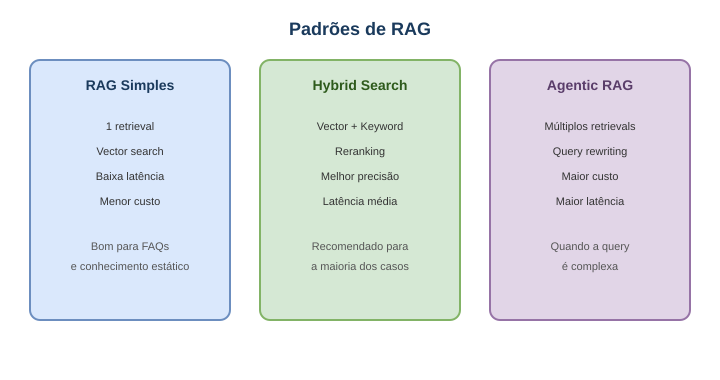

# Chapter 5 — RAG and Retrieval Architectures

RAG is not a vector database with an LLM in front of it. It is the decision of where to put the truth and how much latency you accept for that.

---

## Why it exists

Models have knowledge frozen at training time. RAG brings external information at generation time. For the architect this is a trade-off of latency, freshness, cost and precision.

---

## Flow

Query arrives, retrieval fetches documents, documents enter the context, model generates. Retrieval is on the latency path. Every millisecond in the search is a millisecond the user waits.

---

## Patterns

| Pattern             | Complexity | Latency    | Precision    | When to use                          | When not to use                     |
|---------------------|------------|------------|--------------|--------------------------------------|-------------------------------------|
| Simple RAG          | Low        | Low        | Medium       | Static knowledge, FAQs               | Queries that need high precision    |
| Hybrid Search       | Medium     | Medium     | High         | Most production cases                | Low volume where simple is enough   |
| Agentic RAG         | High       | High       | Very high    | Complex queries, multi-hop           | Aggressive latency SLA              |
| Graph RAG           | High       | Medium-High| High         | Data with strong relationships       | Data without graph structure        |

---

## Decisions

Where does the index live? Managed (Azure AI Search) reduces operations and charges per query. Self-hosted gives control and adds operations. At low volume, managed almost always wins.

Retrieval strategy: pure vector is fast and misses exact matches. Hybrid improves precision in most cases. Reranking increases precision and adds 100–300 ms.

Freshness: nearly static data accepts periodic reindexing. Data that changes frequently needs incremental indexing. Real-time data rarely fits traditional RAG without short cache.

Each retrieval typically adds 50–200 ms. Agentic RAG can multiply the number of retrievals and the latency.

---

## When to use / when not to use

| Situation                             | Recommendation                        | What breaks if wrong                      |
|--------------------------------------|---------------------------------------|-------------------------------------------|
| Internal company knowledge           | Hybrid RAG                            | Fine-tuning only: data becomes outdated   |
| Data that changes constantly         | RAG with incremental indexing         | Fine-tuning: too slow                     |
| Need for source citation             | RAG                                   | Without RAG: model invents the source     |
| Purely generative task               | No RAG                                | RAG: unnecessary latency                  |
| Very high volume + static data       | Evaluate fine-tuning or cache         | Pure RAG: cost per query rises            |

---

## Checklist

- [ ] Can I explain why RAG puts latency on the critical path?
- [ ] Do I know the difference between simple, hybrid and agentic RAG?
- [ ] Do I have a criterion to decide between managed and self-hosted?
- [ ] Do I understand the trade-off between data freshness and indexing complexity?
- [ ] Can I map a RAG architecture to Azure?

---

Next: Agents and Agentic Systems. Where the system stops only answering and starts acting.
