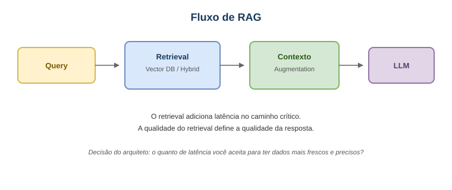

# Capítulo 5 — RAG e Retrieval Architectures
## Como o arquiteto desenha sistemas que combinam dados e geração

> “RAG não é um banco de vetores com um LLM na frente. É uma decisão arquitetural sobre onde colocar a verdade.”

---

## Por que RAG existe

Modelos de linguagem têm conhecimento congelado no momento do treinamento. RAG (Retrieval-Augmented Generation) resolve isso trazendo informação externa no momento da geração.

Para o arquiteto, RAG é um padrão de system design com trade-offs claros de:
- Latência
- Frescor dos dados
- Custo
- Complexidade operacional
- Precisão da resposta

---

## O fluxo básico

1. A query do usuário chega
2. O sistema faz retrieval (busca os documentos mais relevantes)
3. Os documentos são injetados no contexto do modelo
4. O modelo gera a resposta com base nesse contexto

**O ponto crítico:** o retrieval está no caminho de latência. Cada milissegundo gasto na busca é milissegundo que o usuário espera.

---

## Padrões de arquitetura

| Padrão              | Complexidade | Latência   | Precisão     | Quando usar                          |
|--------------------|--------------|-----------|-------------|--------------------------------------|
| **RAG Simples**        | Baixa        | Baixa     | Média       | Conhecimento estático, FAQs          |
| **Hybrid Search**      | Média        | Média     | Alta        | Maioria dos casos de produção        |
| **Agentic RAG**        | Alta         | Alta      | Muito alta  | Queries complexas, multi-hop         |
| **Graph RAG**          | Alta         | Média-Alta| Alta        | Dados com relacionamentos fortes     |

---

## Decisões que o arquiteto precisa tomar

### 1. Onde vive o índice?
- **Managed** (Azure AI Search, Pinecone, etc.): menor operação, custo por query
- **Self-hosted** (Qdrant, Milvus, Weaviate no AKS): mais controle, mais operação

### 2. Qual estratégia de retrieval?
- Vector search puro → rápido, mas pode perder matches exatos
- Hybrid (vector + keyword) → melhor precisão na maioria dos casos
- Com reranking → maior precisão, maior latência

### 3. Como manter os dados frescos?
| Necessidade de frescor     | Estratégia                          |
|----------------------------|-------------------------------------|
| Dados quase estáticos      | Reindexação periódica (diária/semanal) |
| Dados que mudam com frequência | Incremental indexing + CDC        |
| Dados em tempo real        | Evitar RAG tradicional ou usar cache curto |

### 4. Impacto no custo e latência
- Cada retrieval adiciona latência (tipicamente 50–200ms)
- Reranking pode adicionar mais 100–300ms
- Agentic RAG pode multiplicar o número de retrievals

---

## Quando usar / quando não usar

| Situação                              | Recomendação                          | Motivo                                      |
|--------------------------------------|---------------------------------------|---------------------------------------------|
| Conhecimento interno da empresa      | RAG (Hybrid)                          | Melhor precisão que fine-tuning sozinho   |
| Dados que mudam constantemente       | RAG com indexação incremental         | Fine-tuning é lento demais                 |
| Necessidade de citação de fontes      | RAG                                   | O modelo pode referenciar os documentos     |
| Tarefa puramente generativa          | Sem RAG                               | Evita latência desnecessária               |
| Volume muito alto + dados estáticos  | Avaliar fine-tuning ou cache          | RAG pode ficar caro em escala               |

---

## Checklist do capítulo

- [ ] Consigo explicar por que RAG coloca latência no caminho crítico?
- [ ] Sei a diferença entre RAG simples, hybrid e agentic?
- [ ] Tenho um framework para decidir entre managed vs self-hosted?
- [ ] Entendo o trade-off entre frescor dos dados e complexidade de indexação?
- [ ] Consigo mapear uma arquitetura RAG para Azure (AI Search + Foundry ou AKS)?

---

## O que vem a seguir

No Capítulo 6 vamos entrar em **Agents e Sistemas Agentic**. Como o arquiteto desenha sistemas que não só respondem, mas agem — e quais são os riscos de amplificação de custo, latência e falha.

Quer ajustes neste capítulo ou seguimos para o Capítulo 6?
