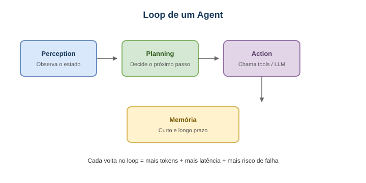
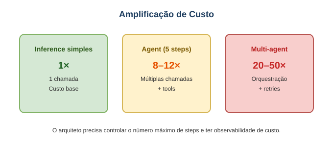

# Capítulo 6 — Agents e Sistemas Agentic
## Perception, Planning, Action e a amplificação de custo

> “Um agent não é uma inference mais inteligente. É um sistema que pode se multiplicar em custo e risco a cada passo.”

---

## O que é um agent para o arquiteto

Um agent é um sistema que:
1. **Percebe** o estado atual
2. **Planeja** o próximo passo
3. **Age** (chamando um modelo, uma tool ou outro sistema)
4. Repete até atingir o objetivo ou um limite

Diferente de uma inference simples, o agent mantém estado, toma decisões intermediárias e pode causar side-effects.

---

## O loop fundamental

Cada volta no loop consome:
- Tokens (custo)
- Tempo (latência)
- Risco de falha ou comportamento inesperado

---

## Amplificação de custo e latência

| Tipo de sistema          | Chamadas de modelo | Custo relativo | Latência relativa |
|--------------------------|--------------------|----------------|------------------|
| Inference simples        | 1                  | 1×             | 1×               |
| Agent com 5 steps        | 5–8                | 8–12×          | 5–10×            |
| Agent com tools          | 8–15               | 12–20×         | 8–15×            |
| Multi-agent              | 15–40              | 20–50×         | 15–30×           |

**Regra do arquiteto:** defina um limite máximo de steps e tenha observabilidade de custo por execução.

---

## Tipos de memória

| Tipo              | Duração     | Uso típico                     | Impacto arquitetural          |
|-------------------|-------------|--------------------------------|-------------------------------|
| Curto prazo       | Sessão     | Contexto da conversa           | KV cache / janela de contexto |
| Longo prazo       | Persistente | Preferências, histórico        | Vector DB ou banco            |
| Episódica         | Por tarefa  | Passos anteriores do agent     | Estado da orquestração       |

---

## Tools e side-effects

Tools são a forma como o agent interage com o mundo real (APIs, bancos, sistemas internos).

**Decisões do arquiteto:**
- Quais tools o agent pode chamar?
- Elas são idempotentes?
- Existe aprovação humana para ações críticas?
- Como isolar o blast radius de uma tool mal comportada?

---

## Multi-agent

Usar vários agents especializados pode melhorar a qualidade, mas aumenta drasticamente a complexidade e o custo.

**Quando considerar:**
- Tarefas que exigem expertises muito diferentes
- Necessidade de debate ou verificação cruzada
- Sistemas onde a separação de responsabilidades reduz risco

**Quando evitar:**
- A maioria dos casos no início
- Quando o custo e a latência são críticos

---

## Framework de decisão

| Pergunta                              | Se sim →                          | Se não →                     |
|---------------------------------------|-----------------------------------|-------------------------------|
| A tarefa exige múltiplos passos?       | Considere agent                   | Use inference simples         |
| Existem side-effects?                 | Adicione controles e HITL         | Pode ser mais autônomo        |
| O custo por execução precisa ser previsível? | Limite steps + observabilidade | Monitore e ajuste depois     |
| Precisa de memória de longo prazo?    | Adicione store externo            | Contexto da sessão basta      |

---

## Quando usar / quando não usar

| Situação                              | Recomendação                          |
|--------------------------------------|---------------------------------------|
| Tarefa de um único passo              | Inference simples                     |
| Processo com 3–7 passos bem definidos | Agent com limite de steps             |
| Ações que alteram sistemas externos   | Agent + human-in-the-loop             |
| Necessidade de máxima autonomia       | Multi-agent (com cuidado)             |
| Orçamento de custo apertado           | Evite agents ou limite fortemente     |

---

## Checklist do capítulo

- [ ] Consigo explicar a diferença entre inference e agent para um stakeholder?
- [ ] Entendo o efeito de amplificação de custo?
- [ ] Sei quando colocar human-in-the-loop?
- [ ] Tenho um framework para decidir se preciso de multi-agent?
- [ ] Consigo mapear um agent para Microsoft Foundry ou orquestração custom?

---

## O que vem a seguir

No Capítulo 7 vamos falar de **Open Weights e AI Local**. Quando faz sentido self-host, quais são os trade-offs reais e como desenhar arquiteturas híbridas.

Quer ajustes neste capítulo ou seguimos para o Capítulo 7?
