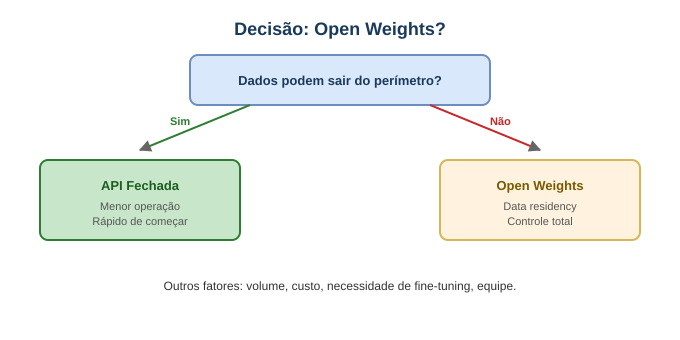
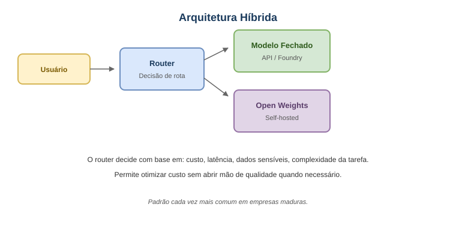

# Capítulo 7 — Open Weights e AI Local
## Quando self-host faz sentido e como desenhar arquiteturas híbridas

> “Open weights não são automaticamente mais baratos. Eles são mais controláveis. O custo depende de como você opera.”

---

## O que são Open Weights

Open weights são modelos cujos pesos são disponibilizados publicamente (Llama, Mistral, Gemma, Phi, etc.). Você pode baixá-los, rodá-los localmente ou na sua infraestrutura e, em muitos casos, fine-tuná-los.

Para o arquiteto, a pergunta não é “open weights são melhores?”. A pergunta é:

**Em quais cenários o controle adicional justifica a complexidade operacional?**

---

## Quando Open Weights fazem sentido

| Fator                        | Favorece Open Weights              | Favorece API Fechada          |
|------------------------------|------------------------------------|-------------------------------|
| Data residency / compliance  | Dados não podem sair             | Dados podem ir para a API     |
| Volume muito alto            | Custo por token menor em escala    | Volume baixo ou médio         |
| Necessidade de fine-tuning   | Você controla o modelo            | Fine-tuning limitado          |
| Latência extremamente baixa   | Pode rodar mais perto do usuário   | Depende da região da API      |
| Equipe e operação             | Tem capacidade de operar GPU       | Quer minimizar operação       |
| Time-to-market               | Mais lento no início               | Muito mais rápido             |

---

## Arquitetura Híbrida

A maioria das empresas maduras não escolhe um ou outro. Elas usam os dois.

**Padrão comum:**
- Modelo fechado (Foundry / Azure OpenAI) para tarefas complexas ou de alta qualidade
- Open weights self-hosted para tarefas de alto volume, dados sensíveis ou custo otimizado
- Um router (ou política) decide qual caminho usar

---

## Engines e quantização

| Engine       | Melhor para                  | Observação                          |
|--------------|------------------------------|------------------------------------|
| vLLM         | Alto throughput              | PagedAttention, muito usado        |
| SGLang       | Baixa latência + structured   | Bom para agents                    |
| Ollama       | Desenvolvimento local        | Simples, não é para produção alta   |
| llama.cpp    | CPU / edge                   | Quantização agressiva               |

**Quantização** reduz o tamanho do modelo e o consumo de HBM, permitindo rodar modelos maiores em menos GPUs — com algum trade-off de qualidade.

---

## Decisões do arquiteto

1. **Qual percentual do tráfego pode ir para open weights?**
2. **Onde rodar?** (AKS + GPU, VMs, Foundry Model Catalog)
3. **Como versionar e atualizar os modelos?**
4. **Qual estratégia de fallback** se o modelo local falhar?
5. **Como medir qualidade** comparada com o modelo fechado?

---

## Quando usar / quando não usar

| Situação                              | Recomendação                          |
|--------------------------------------|---------------------------------------|
| Dados altamente sensíveis             | Open weights                          |
| Volume baixo, precisa entregar rápido | API fechada                           |
| Alto volume + dados mistos           | Arquitetura híbrida                   |
| Necessidade de fine-tuning frequente | Open weights                          |
| Equipe pequena sem experiência em GPU | Comece com API, evolua depois         |

---

## Checklist do capítulo

- [ ] Consigo explicar quando open weights são uma decisão de arquitetura e não só de custo?
- [ ] Entendo o padrão de arquitetura híbrida?
- [ ] Sei os principais engines e quando usar cada um?
- [ ] Tenho um framework para decidir entre API e self-hosted?
- [ ] Consigo mapear isso para Azure (Foundry + AKS/ND-series)?

---

## O que vem a seguir

Com o Capítulo 7 fechamos a **Part II — Core Patterns**.  
No Capítulo 8 entramos na **Part III — Azure Architecture Patterns**, começando por **Microsoft Foundry e padrões de agentes**.

Quer ajustes neste capítulo ou seguimos para o Capítulo 8?
