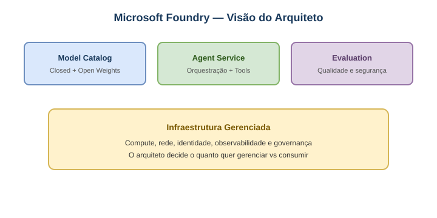

# Capítulo 8 — Microsoft Foundry e Padrões de Agentes

Foundry tira a operação de GPU da sua mesa. O que sobra é decidir o que você não pode terceirizar: limites de agent, data residency e quando o custo de um loop de tools justifica o risco.

---

## O que a plataforma realmente abstrai

Foundry dá acesso a modelos, orquestração de agents e avaliação em um ambiente gerenciado. Isso reduz o tempo para o primeiro agent funcionar. Não reduz a responsabilidade pelas decisões que afetam custo, risco e qualidade.

| Camada              | O que a plataforma faz                    | O que continua sendo seu problema          |
|---------------------|-------------------------------------------|--------------------------------------------|
| Model Catalog       | Disponibiliza modelos closed e open       | Escolher o modelo e o ponto de roteamento  |
| Agent Service       | Roda o loop, tools e memória                | Definir limites de steps, tools e HITL     |
| Evaluation          | Oferece métricas de qualidade e segurança   | Decidir quais métricas importam para o negócio |
| Infraestrutura      | Provisiona compute, rede e identidade     | Isolamento, governança e data residency    |

Na prática, a maioria dos times usa Foundry para entregar o primeiro agent e só sai dele quando o custo por execução ou o requisito de controle de inference fica maior do que a plataforma resolve.

---

## Padrões de agents e quando cada um quebra

| Padrão              | Complexidade | Controle | Quando funciona                        | Quando quebra                              |
|--------------------|--------------|----------|----------------------------------------|--------------------------------------------|
| Single Agent       | Baixa        | Alto     | Tarefa bem definida, poucos tools      | Precisa de especialização ou contexto longo |
| Agent + Tools      | Média        | Alto     | Maioria dos casos de negócio            | Tools têm side-effects sem HITL            |
| Multi-Agent        | Alta         | Médio    | Processo com etapas claramente separadas | Coordenação fica mais cara que o valor     |

Comece com Single Agent ou Agent + Tools. Multi-Agent só vale quando você já mediu que um agent único não consegue manter qualidade ou que o custo de contexto está explodindo.

---

## Foundry vs self-managed: o trade-off real

| Critério                     | Foundry                          | AKS + vLLM/SGLang                     |
|------------------------------|----------------------------------|---------------------------------------|
| Tempo até o primeiro agent   | Dias                             | Semanas                               |
| Controle de inference        | Limitado                         | Total (quantização, batching, cache)  |
| Operação de GPU              | Baixa                            | Alta                                  |
| Custo em volume alto e estável| Pode ficar mais caro             | Costuma ficar menor                   |
| Data residency / isolamento  | Depende da configuração           | Total                                 |

Foundry ganha quando a equipe é pequena ou o volume ainda não justifica operar GPU. Self-managed ganha quando o custo por milhão de tokens ou o requisito de dados que não podem sair do perímetro passam a ser o problema principal.

---

## Governança que importa

Três pontos que quebram agents em produção:

1. Tools com side-effects sem aprovação humana.
2. Ausência de limite de steps (o custo cresce sem teto).
3. Falta de observabilidade do loop inteiro (não só do modelo).

Mesmo no Foundry você precisa de custo por execução, número de steps, taxa de falha de tools e um caminho de fallback simples.

---

## Quando usar / quando não usar

| Situação                              | Recomendação                          | Motivo principal                     |
|--------------------------------------|---------------------------------------|--------------------------------------|
| Primeiro agent, equipe pequena       | Foundry                               | Velocidade de entrega                |
| Volume alto e custo por token importa| AKS + engine open source              | Controle de utilization              |
| Dados sensíveis que não podem sair    | Self-managed ou híbrido                | Data residency                       |
| Precisa de fine-tuning profundo      | Avaliar self-managed                  | Foundry tem limites de customização    |
| Requisitos de rede muito específicos  | Self-managed                          | Controle de isolamento               |

---

## Checklist

- [ ] Sei o que o Foundry tira da minha mesa e o que continua sendo meu problema?
- [ ] Tenho limite de steps e HITL definidos antes de colocar o agent em produção?
- [ ] Consigo justificar Foundry vs self-managed com número de volume ou requisito de dados?
- [ ] O custo por execução é observável?
- [ ] Existe fallback simples se o loop de tools falhar?

---

Próximo capítulo: Compute Patterns no Azure. É onde as decisões de plataforma encontram as escolhas concretas de SKU e orquestração.
