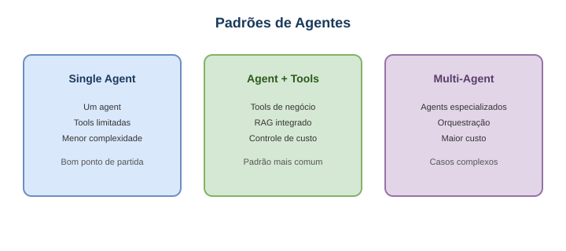

# Capítulo 8 — Microsoft Foundry e Padrões de Agentes
## Como o arquiteto usa a plataforma sem perder o controle do design

> “Foundry não substitui o arquiteto. Ele muda o nível em que o arquiteto toma decisões.”

---

## O que é o Microsoft Foundry para o arquiteto

Microsoft Foundry é a plataforma que reúne modelos, agents, avaliação e ferramentas de desenvolvimento em um ambiente mais gerenciado.

Do ponto de vista de system design, o arquiteto precisa entender:

- O que a plataforma abstrai
- O que ainda continua sendo responsabilidade dele
- Quando faz sentido usar Foundry vs construir em cima de AKS + engines open source

---

## Visão de camadas

| Camada              | O que a plataforma oferece          | O que o arquiteto ainda decide      |
|---------------------|-------------------------------------|-------------------------------------|
| Model Catalog       | Acesso a modelos closed e open      | Qual modelo usar e quando           |
| Agent Service       | Orquestração, tools, memória        | Limites, tools permitidas, HITL     |
| Evaluation          | Métricas de qualidade e segurança     | Quais métricas importam para o negócio |
| Infraestrutura      | Compute, rede, identidade           | Nível de isolamento e governança     |

---

## Padrões de agentes

| Padrão              | Complexidade | Controle | Quando usar                          |
|--------------------|--------------|----------|--------------------------------------|
| **Single Agent**       | Baixa        | Alto     | Tarefas bem definidas                |
| **Agent + Tools**      | Média        | Alto     | Maioria dos casos de negócio         |
| **Multi-Agent**        | Alta         | Médio    | Processos complexos com especialização |

**Recomendação:** comece com Single Agent ou Agent + Tools. Só avance para Multi-Agent quando houver evidência clara de benefício.

---

## Decisões importantes do arquiteto

### 1. Foundry vs Self-managed
| Critério                     | Foundry                          | AKS + vLLM/SGLang               |
|------------------------------|----------------------------------|---------------------------------|
| Velocidade de entrega        | Alta                             | Média                           |
| Controle fino                | Médio                            | Alto                            |
| Operação                     | Menor                            | Maior                           |
| Customização de inference    | Limitada                         | Total                           |
| Custo em escala muito alta   | Pode ser maior                   | Potencialmente menor            |

### 2. Governança de tools
- Quais tools o agent pode chamar?
- Existe aprovação humana para ações críticas?
- Como auditar as chamadas?

### 3. Observabilidade
Mesmo em plataforma gerenciada, o arquiteto precisa de:
- Custo por execução de agent
- Número de steps
- Taxa de falha de tools
- Qualidade das respostas

---

## Quando usar / quando não usar

| Situação                              | Recomendação                          |
|--------------------------------------|---------------------------------------|
| Quer entregar rápido um agent         | Foundry                               |
| Precisa de controle total de inference | AKS + engine open source            |
| Mistura de modelos closed e open     | Foundry (ou híbrido)                   |
| Requisitos muito específicos de rede  | Avaliar self-managed                  |
| Equipe pequena                       | Foundry                               |

---

## Checklist do capítulo

- [ ] Consigo explicar o que o Foundry abstrai e o que continua sendo minha responsabilidade?
- [ ] Sei a diferença entre os principais padrões de agents?
- [ ] Tenho critérios para decidir entre Foundry e self-managed?
- [ ] Entendo como governar tools e side-effects?
- [ ] Consigo desenhar um agent no Foundry com limites claros de custo e risco?

---

## O que vem a seguir

No Capítulo 9 vamos falar de **Compute Patterns no Azure** (ND-series, AKS + vLLM/SGLang, CycleCloud/Slurm). É o capítulo que conecta as decisões de plataforma com as escolhas concretas de infraestrutura.

Quer ajustes neste capítulo ou seguimos para o Capítulo 9?
