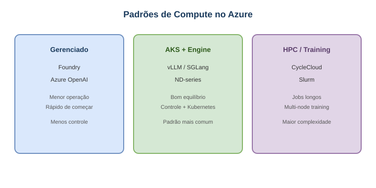
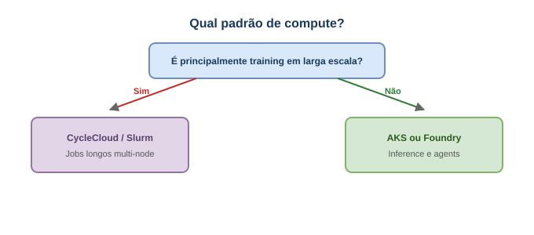

# Capítulo 9 — Compute Patterns no Azure

A escolha do padrão de compute define o quanto de controle e o quanto de operação você vai carregar nos próximos 12 meses. Errar aqui é caro de desfazer.

---

## Os três padrões

| Padrão                  | Melhor para                     | Controle | Operação | Quando quebra                          |
|------------------------|---------------------------------|----------|-----------|----------------------------------------|
| Gerenciado (Foundry)   | Velocidade e equipe pequena    | Baixo    | Baixa     | Volume alto ou controle fino de inference |
| AKS + Engine           | Equilíbrio controle/operação   | Alto     | Média     | Equipe sem maturidade em Kubernetes/GPU |
| HPC (CycleCloud/Slurm) | Training em larga escala       | Muito alto| Alta     | Inference online ou jobs curtos        |

A maioria dos times começa gerenciado e só migra quando o custo por token ou o requisito de customização de inference passa a doer.

---

## ND-series: o que realmente importa

As VMs ND-series (H100, H200, B200) são a base. O arquiteto precisa saber três coisas:

- Quantidade de HBM por GPU (define se o modelo cabe sem quantização agressiva).
- Presença de NVLink (scale-up dentro do nó).
- Opção de InfiniBand (scale-out entre nós).

InfiniBand é quase sempre desperdício para inference. É obrigatório para training distribuído de modelos grandes. Escolher a SKU errada aqui trava o design por meses.

---

## AKS + vLLM / SGLang

Esse é o padrão quando você precisa de continuous batching, PagedAttention e controle de quantização sem montar um cluster HPC.

Decisões que mudam o resultado:

- Tamanho do node pool e estratégia de autoscaling (GPU demora para subir).
- Como fazer rollout de novo modelo sem derrubar requests em andamento.
- Observabilidade de GPU utilization e KV cache hit rate.

Sem isso, o cluster fica caro e subutilizado. Com isso, você consegue custo por token competitivo com Foundry em volume alto.

---

## CycleCloud / Slurm

Serve para jobs que duram horas ou dias e precisam de gang scheduling e InfiniBand. Não serve para inference online. O overhead operacional é alto e só se justifica quando o job de training não pode recomeçar do zero.

---

## Framework de decisão

Pergunte nesta ordem:

1. O workload principal é training ou inference/agents?
2. Quanto controle sobre o engine de inference você realmente precisa?
3. A equipe opera Kubernetes ou Slurm hoje?
4. O volume atual ou projetado justifica a complexidade?

Se a resposta para 3 for não e o volume ainda for baixo, fique no gerenciado. Migrar depois é possível. Começar self-managed sem capacidade operacional gera dívida rápida.

---

## Quando usar / quando não usar

| Situação                              | Padrão recomendado                    | Motivo principal                  |
|--------------------------------------|---------------------------------------|-----------------------------------|
| Começar rápido, equipe pequena        | Foundry                               | Velocidade de entrega             |
| Inference em escala com controle     | AKS + vLLM/SGLang                     | Utilization e custo por token     |
| Training de modelo grande            | CycleCloud / Slurm                    | InfiniBand + scheduling           |
| Mistura de inference e training      | Ambientes separados                   | Perfis de carga diferentes        |
| Equipe sem experiência em GPU          | Gerenciado                            | Risco operacional                 |

---

## Checklist

- [ ] Sei a diferença prática entre os três padrões e quando cada um quebra?
- [ ] Consigo justificar AKS + vLLM vs Foundry com volume ou requisito de controle?
- [ ] Entendo por que InfiniBand quase nunca vale para inference?
- [ ] Tenho critério para não começar self-managed sem capacidade operacional?
- [ ] Consigo explicar a escolha para um stakeholder sem listar serviços?

---

Próximo capítulo: Networking, Storage e Data Patterns. Rede e dados deixam de ser detalhe e passam a afetar tempo de training, latência de RAG e viabilidade de scale-out.
