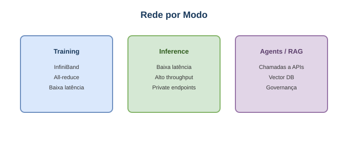

# Chapter 10 — Networking, Storage and Data Patterns

In AI, network and storage stop being commodities. They determine whether training finishes on time, whether RAG fits the latency SLA and whether data cost explodes.

---

## Why it changes the game

In traditional workloads you size network and storage later. In AI they enter the design from the start because:

- Distributed training is limited by bandwidth between GPUs.
- RAG adds retrieval latency that competes with generation time.
- Large and frequent checkpoints become cost and resume risk.

---

## Data patterns

| Data type            | Characteristic                    | Typical service                 | What breaks if wrong               |
|----------------------|---------------------------------|---------------------------------|------------------------------------|
| Training data        | High volume, high throughput    | Blob / ADLS                     | Slow job or egress cost            |
| Checkpoints          | Large and frequent writes       | Blob                            | Loss of progress or high cost      |
| Vector / RAG         | Low search latency              | Azure AI Search                 | Total latency above SLA            |
| Model artifacts      | Versioning and rollback         | Blob + tags                     | Deploy that does not roll back     |

Define checkpoint lifecycle from the first job. Without it storage grows without control.

---

## Network by mode

| Mode          | Real requirement                   | Typical decision                   | When it overdoes                   |
|---------------|------------------------------------|-------------------------------------|-------------------------------------|
| Training      | High bandwidth + low latency       | InfiniBand                          | Small clusters or inference        |
| Inference     | Latency to the user                | Private Link + proximity            | InfiniBand                          |
| RAG           | Latency to the vector store        | Co-location when possible           | Vector store in another region     |
| Agents        | Calls to multiple systems          | Observability and governance        | Open network without control       |

InfiniBand for inference is the most common mistake. Cost goes up and the latency gain is negligible compared to decode time.

---

## Decisions that matter

Where to place the RAG vector store? Close to the model reduces latency. In a managed service it reduces operations. The choice depends on SLA and volume. At low volume, managed almost always wins.

For training, prefer direct reads from Blob/ADLS. Copying data to the cluster before the job adds time and cost without clear benefit in most cases.

Private Endpoints for Storage, AI Search and Foundry are the standard in enterprise environments. Unnecessary public exposure creates risk without performance gain.

---

## When to use / when not to use

| Situation                             | Recommendation                        | Main reason                       |
|--------------------------------------|---------------------------------------|-----------------------------------|
| Large-scale training                 | InfiniBand + high-throughput Blob     | Bandwidth between nodes           |
| RAG with aggressive latency SLA      | Co-located vector store               | Reduce round-trip                 |
| Sensitive data                       | Private Endpoints                     | Isolation                         |
| Low volume RAG                       | Managed service                       | Less operations                   |
| Many checkpoints                     | Aggressive lifecycle                  | Cost control                      |

---

## Checklist

- [ ] Do I know why InfiniBand is almost never worth it for inference?
- [ ] Do I have a lifecycle defined for checkpoints?
- [ ] Can I explain the latency impact of the vector store on RAG?
- [ ] Are Private Endpoints the standard or still an exception?
- [ ] Can I estimate whether storage will be a relevant cost?

---

Next chapter: Landing Zones and Governance. The foundation that prevents each team from inventing its own way of doing the same thing.
