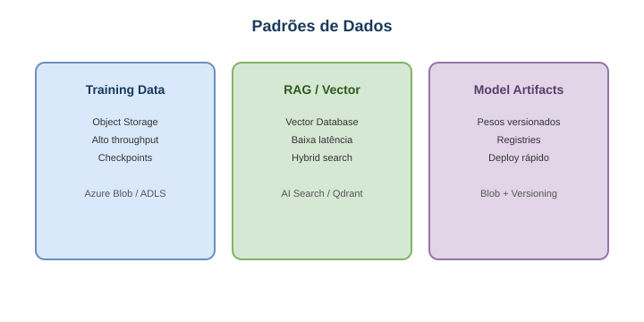

# Capítulo 10 — Networking, Storage e Data Patterns
## Como rede e dados afetam as decisões de arquitetura de AI

> “Em AI, a rede e o storage deixam de ser detalhes de infraestrutura e passam a ser parte do design do sistema.”

---

## Por que isso importa

Nos workloads tradicionais, rede e storage são frequentemente tratados como commodities. Em AI, eles impactam diretamente:

- Tempo de treinamento
- Latência de inference
- Custo de RAG
- Viabilidade de scale-out

---

## Padrões de dados

| Tipo de dado         | Característica principal     | Serviço típico no Azure      | Preocupação do arquiteto      |
|----------------------|----------------------------|-------------------------------|-------------------------------|
| Training data        | Alto volume, alto throughput | Blob Storage / ADLS           | Custo e velocidade de leitura |
| Checkpoints          | Escrita frequente e grande   | Blob Storage                  | Durabilidade e retomada       |
| Vector / RAG         | Baixa latência de busca      | Azure AI Search               | Frescor e precisão            |
| Model artifacts      | Versionamento                | Blob + tagging                | Deploy e rollback             |

---

## Considerações de rede

| Modo          | Requisito de rede                  | Decisão típica                     |
|---------------|------------------------------------|--------------------------------------|
| **Training**      | Altíssima banda + baixa latência    | InfiniBand                           |
| **Inference**     | Baixa latência para o usuário       | Private Link + proximidade           |
| **RAG**           | Latência para o vector store       | Co-localização quando possível      |
| **Agents**        | Chamadas a múltiplos sistemas       | Governança e observabilidade         |

---

## Decisões do arquiteto

### 1. Onde colocar os dados de RAG?
- Perto do modelo de inference reduz latência.
- Em serviço gerenciado (AI Search) reduz operação.

### 2. Como mover dados para training?
- Evite copiar dados desnecessariamente.
- Prefira leitura direta de Blob/ADLS quando possível.

### 3. Private networking
Para a maioria dos cenários enterprise:
- Private Endpoints para AI Search, Storage e Foundry
- Evitar exposição pública desnecessária

### 4. Custo de storage
Dados de training e checkpoints podem ficar caros. Defina políticas de lifecycle desde o início.

---

## Quando usar / quando não usar

| Situação                              | Recomendação                          |
|--------------------------------------|---------------------------------------|
| Training em larga escala             | InfiniBand + Blob de alto throughput  |
| RAG com SLA de latência               | Vector store co-localizado            |
| Dados sensíveis                       | Private Endpoints + encryption        |
| Volume baixo de RAG                  | Serviço gerenciado                    |
| Muitos checkpoints                   | Lifecycle policy agressiva            |

---

## Checklist do capítulo

- [ ] Consigo explicar por que InfiniBand importa para training?
- [ ] Sei os principais padrões de armazenamento para AI?
- [ ] Entendo o impacto de latência do vector store no RAG?
- [ ] Tenho uma estratégia de private networking?
- [ ] Consigo estimar o impacto de storage no custo total?

---

## O que vem a seguir

No Capítulo 11 vamos falar de **Landing Zones e Governança para AI**. Como estruturar a base de Azure para que os times possam construir com segurança e consistência.

Quer ajustes neste capítulo ou seguimos para o Capítulo 11?
