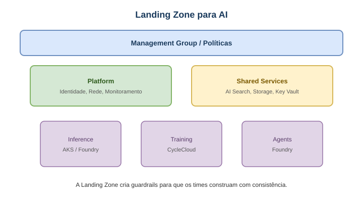

# Capítulo 11 — Landing Zones e Governança para AI
## Criando a base para que os times construam com segurança

> “Uma boa Landing Zone não impede a inovação. Ela impede que cada time invente a sua própria forma de fazer a mesma coisa.”

---

## Por que Landing Zone para AI

Workloads de AI têm características específicas:
- Alto custo de compute
- Necessidade de GPU
- Dados sensíveis
- Novos tipos de risco (agents com side-effects)

Uma Landing Zone bem desenhada cria guardrails para que os times possam se mover rápido sem criar dívida técnica ou riscos desnecessários.

---

## Estrutura conceitual

| Camada              | Responsabilidade                          | Exemplos                              |
|---------------------|-------------------------------------------|---------------------------------------|
| Management          | Políticas globais                          | Azure Policy, Management Groups       |
| Platform            | Serviços compartilhados                    | Identidade, Rede, Monitoramento       |
| Shared Services     | Serviços usados por vários workloads       | AI Search, Storage, Key Vault         |
| Workloads           | Aplicações de AI                           | Inference, Training, Agents           |

---

## Camadas de governança

### 1. Políticas
- Restringir regiões
- Exigir tags de custo
- Controlar quais SKUs de GPU podem ser usados

### 2. Identidade
- Managed Identity sempre que possível
- Princípio do menor privilégio para agents e tools

### 3. Rede
- Private Endpoints como padrão
- Evitar exposição pública desnecessária

### 4. Observabilidade e Custo
- Todo workload de AI deve ter visibilidade de custo
- Agents precisam de rastreabilidade de steps e tool calls

---

## Decisões do arquiteto

| Decisão                              | Recomendação                              |
|--------------------------------------|-------------------------------------------|
| Quantas subscriptions?               | Separar por ambiente e criticidade        |
| Quem pode criar recursos de GPU?     | Controlado via Policy + RBAC              |
| Como tratar dados sensíveis?          | Subscription ou resource group dedicado   |
| Padrão de rede                         | Hub-spoke ou Virtual WAN com Private Link |
| Observabilidade                      | Centralizada desde o início                 |

---

## Quando usar / quando não usar

| Situação                              | Abordagem                             |
|--------------------------------------|---------------------------------------|
| Empresa com múltiplos times de AI     | Landing Zone estruturada              |
| Projeto piloto pequeno               | Pode começar mais simples              |
| Requisitos fortes de compliance      | Governança rígida desde o início         |
| Crescimento rápido esperado           | Invista na Landing Zone cedo          |

---

## Checklist do capítulo

- [ ] Consigo explicar o valor de uma Landing Zone para stakeholders?
- [ ] Sei as principais camadas de governança para AI?
- [ ] Tenho uma visão de como separar platform de workloads?
- [ ] Entendo como aplicar Private Endpoints e RBAC nesse contexto?
- [ ] Consigo propor uma estrutura inicial de Landing Zone?

---

## O que vem a seguir

Com o Capítulo 11 fechamos a **Part III — Azure Architecture Patterns**.

No Capítulo 12 entramos na **Part IV — Decision Frameworks**, começando por **Cost, FinOps e Observabilidade para Arquitetos**.

Quer ajustes neste capítulo ou seguimos para o Capítulo 12?
