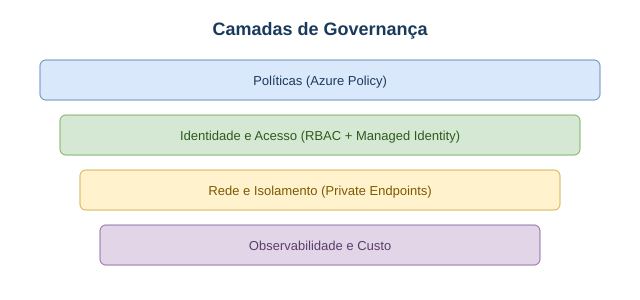

# Capítulo 11 — Landing Zones e Governança para AI

Uma Landing Zone boa não impede inovação. Ela impede que cada time invente a sua própria forma de fazer a mesma coisa e crie dívida ou risco que o resto da empresa paga depois.

---

## Por que AI precisa de governança específica

Workloads de AI adicionam três problemas que landing zones tradicionais não cobriam bem:

- Custo de GPU que cresce rápido e é difícil de prever.
- Agents que executam ações com side-effects.
- Dados que não podem sair de um perímetro definido.

Sem guardrails, o primeiro time que coloca um agent em produção define o padrão (ou a falta dele) para os próximos.

---

## Estrutura

| Camada              | Responsabilidade                          | O que acontece se falhar              |
|---------------------|-------------------------------------------|---------------------------------------|
| Management          | Políticas globais                         | SKUs caras liberadas sem controle     |
| Platform            | Identidade, rede, monitoramento           | Cada workload inventa o seu próprio   |
| Shared Services     | AI Search, Storage, Key Vault             | Duplicação e inconsistência            |
| Workloads           | Inference, training, agents               | Isolamento fraco ou custo invisível   |

A separação entre platform e workloads é o que permite o time de AI se mover sem pedir permissão para cada recurso, desde que fique dentro dos guardrails.

---

## Camadas que importam

Políticas: restringir regiões e SKUs de GPU, exigir tags de custo. Sem isso o primeiro cluster H100 aparece em uma subscription de teste.

Identidade: Managed Identity e menor privilégio para agents e tools. Agents com permissão ampla são o vetor de risco mais novo.

Rede: Private Endpoints como padrão. Exposição pública de AI Search ou Storage cria risco sem ganho mensurável na maioria dos casos.

Observabilidade e custo: todo workload de AI precisa de visibilidade de custo por execução ou por job. Agents precisam de rastreabilidade de steps e tool calls. Sem isso o FinOps chega tarde.

---

## Decisões práticas

| Decisão                              | Recomendação                              | Por quê                                 |
|--------------------------------------|-------------------------------------------|----------------------------------------|
| Quantas subscriptions?               | Separar por ambiente e criticidade        | Isolamento de custo e risco            |
| Quem cria recursos de GPU?           | Policy + RBAC                             | Evitar surpresa de custo               |
| Dados sensíveis                      | Subscription ou resource group dedicado   | Perímetro claro                        |
| Padrão de rede                       | Hub-spoke ou Virtual WAN + Private Link   | Consistência                           |
| Observabilidade                      | Centralizada desde o início                | Custo e risco visíveis cedo            |

---

## Quando usar / quando não usar

| Situação                              | Abordagem                             | Motivo principal                  |
|--------------------------------------|---------------------------------------|-----------------------------------|
| Múltiplos times de AI                  | Landing Zone estruturada              | Evitar divergência                |
| Projeto piloto pequeno               | Pode começar mais simples             | Velocidade                        |
| Requisitos fortes de compliance      | Governança rígida desde o início        | Risco regulatório                 |
| Crescimento rápido esperado           | Invista na Landing Zone cedo          | Custo de corrigir depois          |

---

## Checklist

- [ ] Consigo explicar para um stakeholder o que a Landing Zone impede que aconteça?
- [ ] Sei quais políticas de GPU e tags são o mínimo viável?
- [ ] Agents e tools têm menor privilégio definido?
- [ ] Private Endpoints são o padrão ou ainda são exceção?
- [ ] Custo por workload de AI é visível antes do primeiro mês de produção?

---

Com este capítulo fechamos a Part III. Próximo: Cost, FinOps e Observabilidade. É onde as decisões de arquitetura encontram o número que o negócio realmente vê.
