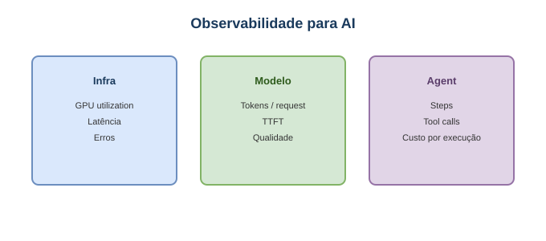

# Capítulo 12 — Cost, FinOps e Observabilidade para Arquitetos
## Como tomar decisões conscientes sobre custo em sistemas de AI

> “Em AI, o custo não é uma consequência. É uma variável de design.”

---

## Por que o arquiteto precisa se importar com custo

Diferente de muitas aplicações tradicionais, o custo em AI pode variar ordens de magnitude dependendo de decisões arquiteturais:

- Escolha do modelo
- Tamanho do contexto
- Número de steps de um agent
- Utilization de GPU
- Estratégia de retrieval

O arquiteto que ignora isso entrega sistemas que funcionam, mas que ninguém consegue pagar em escala.

---

## Principais drivers de custo

| Driver              | O que influencia                          | Alavanca do arquiteto                  |
|---------------------|-------------------------------------------|----------------------------------------|
| **Compute (GPU)**       | Utilization, tipo de GPU, tempo de uso    | Batching, quantização, right-sizing    |
| **Tokens**              | Tamanho de input/output, steps de agent   | Limitar contexto e steps               |
| **Dados & Storage**     | Volume de training data, vector DB        | Lifecycle, compressão, retenção        |
| **Rede**                | Egress, transferência de dados             | Co-localização, Private Link            |

---

## Modelos de custo por modo

| Modo          | Unidade principal de custo     | Como o arquiteto controla               |
|---------------|--------------------------------|-----------------------------------------|
| **Training**      | GPU-hours                      | Duração do job, eficiência de paralelismo |
| **Inference**     | Custo por milhão de tokens      | Modelo, quantização, batching           |
| **Agents**        | Tokens × steps                  | Limite de steps, escolha de tools       |
| **RAG**           | Retrieval + tokens             | Qualidade do índice, reranking         |

---

## Observabilidade além da infraestrutura

O arquiteto precisa garantir visibilidade em três níveis:

1. **Infraestrutura** — GPU utilization, latência, erros
2. **Modelo** — tokens por request, TTFT, qualidade
3. **Agent / Aplicação** — número de steps, tool calls, custo por execução

Sem o terceiro nível, é impossível entender por que o custo de um agent explodiu.

---

## Práticas de FinOps para AI

| Prática                          | Benefício                              |
|----------------------------------|---------------------------------------|
| Tagging consistente              | Visibilidade por time / produto       |
| Orçamentos e alertas              | Evita surpresas                       |
| Right-sizing de GPU              | Reduz desperdício                      |
| Limites de steps em agents       | Controla amplificação de custo        |
| Avaliação periódica de modelos    | Troca para modelos mais baratos quando possível |

---

## Quando usar / quando não usar

| Situação                              | Abordagem                             |
|--------------------------------------|---------------------------------------|
| Alto volume de inference             | Otimizar utilization e quantização     |
| Agents em produção                    | Limites rígidos de steps + observabilidade |
| Training frequente                   | Monitorar GPU-hours de perto          |
| Projeto piloto                       | Aceitar custo maior no início          |
| Necessidade de previsibilidade       | Modelos gerenciados + limites         |

---

## Checklist do capítulo

- [ ] Consigo identificar os principais drivers de custo de um sistema de AI?
- [ ] Sei a diferença de modelo de custo entre training, inference e agents?
- [ ] Entendo por que observabilidade de agent é diferente de observabilidade tradicional?
- [ ] Tenho práticas de FinOps aplicáveis a workloads de AI?
- [ ] Consigo estimar o impacto de uma decisão arquitetural no custo?

---

## O que vem a seguir

No Capítulo 13 vamos falar de **Security, Privacy e Compliance em AI**. Como o arquiteto trata dados sensíveis, isolamento e riscos específicos de sistemas agentic.

Quer ajustes neste capítulo ou seguimos para o Capítulo 13?
