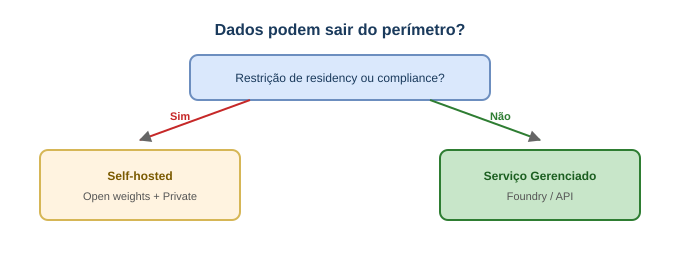

# Chapter 13 — Security, Privacy and Compliance

In AI the risk is not only in who accesses the system. It is in what the system decides to do with the data and the tools.

---

## What changes

Sensitive data can go to external models. Agents execute actions with side-effects. Probabilistic decisions are harder to audit. Prompt injection is a new vector. These risks need to enter the design, not after.

---

## Layers

| Layer                   | What it protects                       | Example controls                     |
|-------------------------|----------------------------------------|--------------------------------------|
| Identity and Access     | Who can invoke models and agents       | RBAC, Managed Identity, Entra ID     |
| Network and Isolation   | Where data travels                     | Private Endpoints, VNet              |
| Data                    | Where data lives and how it is protected | Encryption, classification, residency |
| Application / Agent     | What the system can do                 | Tool limits, HITL, auditing          |

---

## Data residency

| Scenario                             | Recommended approach                  | What breaks if wrong                   |
|--------------------------------------|---------------------------------------|----------------------------------------|
| Data can go to managed service       | Foundry / Azure OpenAI with Private Link | Unnecessary self-hosted: extra operations |
| Data cannot leave the perimeter      | Self-hosted open weights              | Everything in API: violates residency  |
| Mixed data                           | Hybrid architecture with routing      | No router: either everything leaves or everything is expensive |
| Strong regulatory requirements       | Isolation + auditing + encryption     | Weak controls: compliance risk         |

---

## Agent risks

| Risk                         | Mitigation                                 |
|------------------------------|--------------------------------------------|
| Tool with critical side-effect | Human-in-the-loop or approval            |
| Prompt injection             | Input isolation + validation               |
| Privilege amplification      | Least privilege principle on tools         |
| Lack of auditing             | Log of steps, tool calls and decisions     |

---

## Architect decisions

1. Which data can leave the perimeter?
2. Which tools can an agent call without human approval?
3. How to audit what an agent did?
4. Does the model need network isolation?
5. Is there data classification that affects model choice?

---

## When to use / when not to use

| Situation                             | Recommendation                        | What breaks if you do not              |
|--------------------------------------|---------------------------------------|----------------------------------------|
| Highly sensitive data                | Self-hosted or strong isolation       | Data leaves the perimeter              |
| Agents with critical actions         | Mandatory HITL                        | Action executed without approval       |
| Regulated environment                | Private networking + auditing         | Exposure or missing trail              |
| Rapid prototyping                    | Accept more risk temporarily          | Rigid controls delay validation        |
| Production with mixed data           | Routing based on classification       | Everything on the same path: risk or cost |

---

## Checklist

- [ ] Can I map the security layers of an AI system?
- [ ] Do I know when data residency forces the decision for open weights?
- [ ] Do I understand the specific risks of agents?
- [ ] Do I have criteria to decide where to place human-in-the-loop?
- [ ] Can I propose security controls without killing usability?

---

Next: Hybrid and Multi-pattern Architectures. How to combine patterns without spreading complexity.
