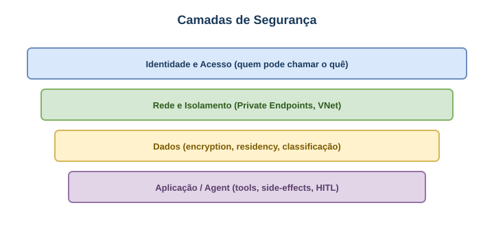

# Capítulo 13 — Security, Privacy e Compliance em AI
## Riscos específicos e como o arquiteto os trata

> “Em AI, o risco não está só em quem acessa o sistema. Está também no que o sistema decide fazer com os dados e as tools.”

---

## Por que AI muda o jogo de segurança

Sistemas de AI introduzem riscos que não existem (ou são menores) em aplicações tradicionais:

- Dados sensíveis sendo enviados para modelos externos
- Agents com capacidade de executar ações (side-effects)
- Dificuldade de auditar decisões probabilísticas
- Novos vetores como prompt injection

O arquiteto precisa tratar esses riscos no design, não depois.

---

## Camadas de segurança

| Camada                  | O que protege                          | Exemplos de controle                     |
|-------------------------|----------------------------------------|------------------------------------------|
| **Identidade e Acesso**     | Quem pode invocar modelos e agents     | RBAC, Managed Identity, Entra ID         |
| **Rede e Isolamento**       | Por onde os dados trafegam             | Private Endpoints, VNet, sem exposição pública |
| **Dados**                   | Onde os dados ficam e como são protegidos | Encryption, classificação, residency   |
| **Aplicação / Agent**        | O que o sistema pode fazer             | Limite de tools, HITL, auditoria         |

---

## Data Residency e Privacy

| Cenário                              | Abordagem recomendada                 |
|--------------------------------------|---------------------------------------|
| Dados podem ir para serviço gerenciado | Foundry / Azure OpenAI com Private Link |
| Dados não podem sair do perímetro    | Open weights self-hosted              |
| Mistura de dados                     | Arquitetura híbrida com roteamento     |
| Requisitos regulatórios fortes       | Isolamento + auditoria + criptografia |

---

## Riscos específicos de Agents

| Risco                        | Mitigação                                  |
|------------------------------|-------------------------------------------|
| Tool com side-effect crítico  | Human-in-the-loop ou aprovação            |
| Prompt injection             | Isolamento de input + validação           |
| Amplificação de privilégio    | Princípio do menor privilégio nas tools    |
| Falta de auditoria           | Log de steps, tool calls e decisões      |

---

## Decisões do arquiteto

1. **Quais dados podem sair do perímetro?**
2. **Quais tools um agent pode chamar sem aprovação humana?**
3. **Como auditar o que um agent fez?**
4. **O modelo precisa de isolamento de rede?**
5. **Existe classificação de dados que afeta a escolha do modelo?**

---

## Quando usar / quando não usar

| Situação                              | Recomendação                          |
|--------------------------------------|---------------------------------------|
| Dados altamente sensíveis             | Self-hosted ou isolamento forte       |
| Agents com ações críticas            | HITL obrigatório                      |
| Ambiente regulado                    | Private networking + auditoria        |
| Prototipagem rápida                  | Aceitar mais risco temporariamente    |
| Produção com dados mistos             | Roteamento baseado em classificação    |

---

## Checklist do capítulo

- [ ] Consigo mapear as camadas de segurança de um sistema de AI?
- [ ] Sei quando data residency força a decisão por open weights?
- [ ] Entendo os riscos específicos de agents?
- [ ] Tenho critérios para decidir onde colocar human-in-the-loop?
- [ ] Consigo propor controles de segurança sem matar a usabilidade?

---

## O que vem a seguir

No Capítulo 14 vamos falar de **Hybrid e Multi-pattern Architectures**. Como combinar os padrões que vimos até aqui em sistemas reais.

Quer ajustes neste capítulo ou seguimos para o Capítulo 14?
