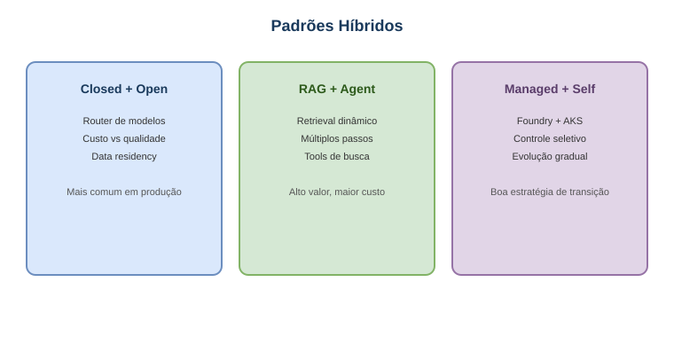
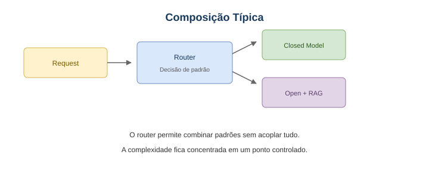

# Chapter 14 — Hybrid and Multi-pattern Architectures

Real architectures rarely use a single pattern. They combine several. The architect's job is to define where each pattern starts and ends, and what happens at the boundary.

---

## Why hybrids appear

Production systems mix closed models and open weights, RAG and agents, managed services and self-hosted. Each combination solves one problem and creates another. The common mistake is to spread the decision logic throughout the system instead of concentrating it.

---

## Common hybrid patterns

| Hybrid Pattern          | When to use                              | Main benefit                     | When it is not worth it                |
|-------------------------|------------------------------------------|----------------------------------|----------------------------------------|
| Closed + Open           | High volume + quality in hard cases      | Optimized cost                   | Low volume or small team               |
| RAG + Agent             | Tasks that need data and action          | Greater capability               | Simple task that inference solves      |
| Managed + Self-hosted   | Transition or selective control          | Operations/control balance       | No clear routing criterion             |
| Prefill/Decode split    | Large inference clusters                 | Better utilization               | Small clusters                         |

Most hybrids are only justified after you have measured the problem that the simple pattern does not solve.

---

## The router as boundary

A router (or orchestration layer) is the place where most pattern decisions should happen:

- Which model to use?
- Does it need RAG?
- Should it go to an agent?
- Which inference pool?

Concentrating the logic there prevents each service from inventing its own rule. It also makes it easier to measure cost, latency and quality per path.

---

## Principles that avoid unnecessary complexity

Clear boundaries. Each pattern has a defined responsibility. If you cannot explain in one sentence what that path does, it is probably doing too much.

Observability at the boundary. Measure cost, latency and quality on each path. Without this you do not know whether the hybrid is winning or just adding operations.

Fallback. Have a simple path when the complex path fails. Agents and complex routers fail. The system needs to keep working.

Gradual evolution. Start simple. Add the next pattern only when there is evidence that the current one does not solve.

---

## When to use / when not to use

| Situation                             | Approach                              | Main reason                       |
|--------------------------------------|---------------------------------------|-----------------------------------|
| Optimize cost at high volume         | Closed + Open with router             | Measurable break-even             |
| Complex tasks with data              | RAG + Agent                           | Capability                        |
| Team in transition                   | Managed + Self-hosted                 | Controlled risk                   |
| System still small                   | Avoid hybrids                         | Premature complexity              |
| Very different requirements per request | Well-defined router                 | Centralized decision              |

---

## Checklist

- [ ] Can I identify when a system really needs more than one pattern?
- [ ] Is the routing logic concentrated or spread out?
- [ ] Does each path have cost and quality observability?
- [ ] Is there a simple fallback?
- [ ] Can I explain why the hybrid is necessary and not just interesting?

---

With this chapter we close Part IV. Next: Case Studies. This is where patterns meet real constraints.
