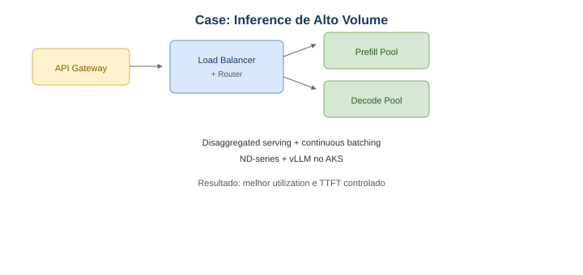
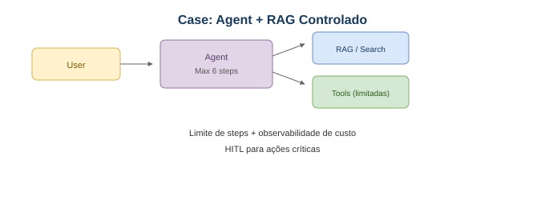

# Capítulo 15 — Case Studies Profundos
## Aplicando os padrões em cenários reais

> “Os padrões só fazem sentido quando você vê como eles se combinam sob restrições reais.”

---

## Como ler este capítulo

Cada case apresenta:
- O problema de negócio
- As restrições (custo, latência, compliance, equipe)
- A arquitetura escolhida
- Os trade-offs aceitos
- O que o arquiteto precisou decidir

Os cases são compostos, mas refletem situações comuns em empresas que operam AI em escala.

---

## Case 1 — Inference de Alto Volume

**Contexto:** Empresa com milhares de requests por minuto de um modelo de linguagem para suporte ao cliente. Requisitos de TTFT baixo e custo controlado.

| Aspecto              | Decisão                              | Motivo                              |
|----------------------|---------------------------------------|-------------------------------------|
| Engine               | vLLM no AKS                           | Continuous batching + PagedAttention |
| Arquitetura          | Disaggregated (Prefill + Decode)      | Otimizar TTFT e throughput          |
| Hardware             | ND-series (H100)                      | HBM suficiente + NVLink             |
| Escala               | Autoscaling por utilization           | Custo sob controle                  |
| Modelo               | Quantizado (FP8)                      | Reduz consumo de HBM                |

**Trade-off aceito:** Maior complexidade operacional em troca de melhor utilization e custo por token.

---

## Case 2 — Agent com RAG Controlado

**Contexto:** Sistema interno que ajuda funcionários a consultar políticas e executar ações simples (abrir tickets, consultar dados). Necessidade de controle de custo e risco.

| Aspecto              | Decisão                              | Motivo                              |
|----------------------|---------------------------------------|-------------------------------------|
| Padrão               | Agent + RAG                           | Precisa de dados + ações             |
| Limite               | Máximo de 6 steps                    | Controlar amplificação de custo       |
| Tools                | Limitadas e auditadas                 | Reduzir risco de side-effects       |
| HITL                 | Para ações que alteram dados         | Segurança                            |
| Observabilidade      | Custo por execução + steps            | Visibilidade para FinOps            |

**Trade-off aceito:** Menor autonomia do agent em troca de previsibilidade de custo e risco.

---

## Case 3 — Arquitetura Híbrida (Closed + Open)

**Contexto:** Empresa com dados sensíveis e alto volume de requests não sensíveis. Quer otimizar custo sem abrir mão de qualidade quando necessário.

| Aspecto              | Decisão                              | Motivo                              |
|----------------------|---------------------------------------|-------------------------------------|
| Router               | Baseado em classificação de dados    | Data residency                      |
| Caminho sensível     | Open weights self-hosted              | Dados não saem                     |
| Caminho geral        | Modelo fechado (Foundry)              | Melhor qualidade                    |
| Fallback             | Sempre tem caminho simples            | Resiliência                         |

**Trade-off aceito:** Complexidade do router em troca de conformidade e otimização de custo.

---

## Lições transversais

1. **Comece simples** e só adicione complexidade quando houver evidência.
2. **Limites explícitos** (steps, tools, custo) são melhores do que confiar no comportamento do modelo.
3. **Observabilidade** precisa cobrir o nível de agent, não só de infraestrutura.
4. **O router** é frequentemente o lugar onde as decisões arquiteturais mais importantes acontecem.

---

## Checklist do capítulo

- [ ] Consigo mapear as decisões dos cases para os capítulos anteriores?
- [ ] Entendo os trade-offs aceitos em cada case?
- [ ] Sei quando disaggregated serving vale a pena?
- [ ] Consigo propor limites claros para um agent?
- [ ] Reconheço o papel do router em arquiteturas híbridas?

---

## O que vem a seguir

No Capítulo 16 vamos consolidar tudo em **Decision Matrices e Checklists** prontos para uso no dia a dia do arquiteto.

Quer ajustes neste capítulo ou seguimos para o Capítulo 16?
