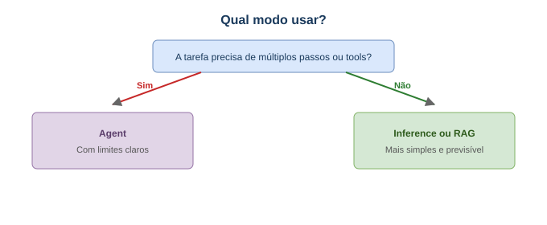

# Capítulo 16 — Decision Matrices e Checklists
## Ferramentas prontas para o dia a dia do arquiteto

> “O valor deste handbook está em ajudar você a tomar decisões melhores, mais rápido.”

---

## Como usar este capítulo

As matrizes e checklists abaixo consolidam o conteúdo dos capítulos anteriores. Use-as como ponto de partida em reuniões de design, reviews de arquitetura ou quando precisar justificar uma decisão.

---

## Matriz de Modo

| Necessidade                          | Modo recomendado     | Complexidade | Custo relativo |
|--------------------------------------|----------------------|--------------|----------------|
| Resposta única, sem estado            | Inference simples    | Baixa        | 1×             |
| Precisa de dados externos atualizados| RAG                  | Média        | 1.5–3×         |
| Múltiplos passos ou ações            | Agent (com limites)  | Alta         | 5–20×          |
| Combinação de dados + ação          | Agent + RAG          | Alta         | 8–25×          |

---

## Matriz de Compute

| Cenário                              | Padrão recomendado          | Observação                     |
|--------------------------------------|----------------------------|--------------------------------|
| Começar rápido                       | Foundry / Gerenciado       | Menor operação                  |
| Inference em escala com controle     | AKS + vLLM/SGLang          | Equilíbrio controle/operação    |
| Training em larga escala             | CycleCloud / Slurm         | Jobs longos                    |
| Alto volume + dados sensíveis        | Híbrido (Managed + Self)    | Router de decisão              |

---

## Matriz de Open Weights

| Fator                        | Favorece Open Weights | Favorece API Fechada |
|------------------------------|-----------------------|----------------------|
| Data residency               | Sim                   | Não                  |
| Volume muito alto            | Sim                   | Não                  |
| Time-to-market               | Não                   | Sim                  |
| Necessidade de fine-tuning   | Sim                   | Não                  |
| Equipe pequena               | Não                   | Sim                  |

---

## Checklist de Design de Inference

- [ ] O modelo cabe na HBM disponível (com quantização)?
- [ ] Prefill e Decode estão otimizados para o perfil de carga?
- [ ] Continuous batching está habilitado?
- [ ] Existe estratégia de autoscaling?
- [ ] TTFT e throughput estão sendo medidos?
- [ ] Custo por milhão de tokens está dentro do esperado?

---

## Checklist de Design de Agent

- [ ] Existe limite máximo de steps?
- [ ] As tools estão com o menor privilégio possível?
- [ ] Ações críticas têm human-in-the-loop?
- [ ] Custo por execução é observável?
- [ ] Existe fallback para caminho simples?
- [ ] Logs de steps e tool calls estão sendo coletados?

---

## Checklist de Arquitetura Híbrida

- [ ] O router tem critérios claros de decisão?
- [ ] Cada caminho tem observabilidade própria?
- [ ] Existe fallback?
- [ ] A complexidade adicional se justifica?
- [ ] A equipe consegue operar a solução?

---

## Checklist de Segurança e Compliance

- [ ] Dados sensíveis têm caminho definido (self-hosted ou isolado)?
- [ ] Private Endpoints estão sendo usados onde faz sentido?
- [ ] Agents têm auditoria de ações?
- [ ] Políticas de Azure Policy cobrem GPU e regiões?
- [ ] Classificação de dados influencia o roteamento?

---

## Checklist de FinOps

- [ ] Workloads de AI estão taggeados?
- [ ] Existem alertas de custo?
- [ ] Utilization de GPU está sendo monitorada?
- [ ] Agents têm limite de custo ou steps?
- [ ] Há revisão periódica de modelos (custo vs qualidade)?

---

## O que vem a seguir

No Capítulo 17 (final) vamos ter o **Glossário Visual para Arquitetos**, consolidando os principais conceitos e diagramas do handbook.

Quer ajustes neste capítulo ou seguimos para o Capítulo 17?
