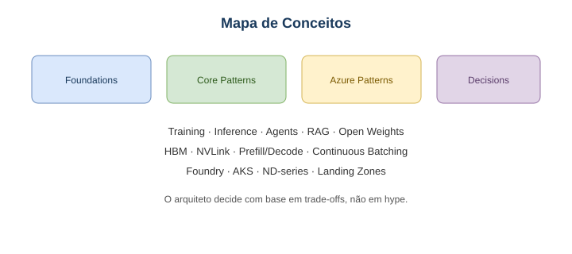

# Chapter 17 — Visual Glossary for Architects

If you can explain these concepts clearly, you can talk at the same level as advanced clients.

---

## Handbook Map

---

## Glossary

| Term                     | Definition for the architect                                    | Chapter |
|--------------------------|----------------------------------------------------------------|---------|
| Prefill                  | Phase that processes the entire prompt (compute-bound)         | 4       |
| Decode                   | Phase that generates tokens one by one (memory-bound)          | 4       |
| Continuous Batching      | Dynamically adds and removes requests for better utilization   | 4       |
| PagedAttention           | Manages KV cache like memory pages                             | 4       |
| Disaggregated Serving    | Separates Prefill and Decode pools                             | 4       |
| HBM                      | High Bandwidth Memory — scarcest resource in inference       | 3       |
| NVLink                   | High-bandwidth interconnect inside the node (scale-up)         | 3       |
| InfiniBand               | Low-latency network between nodes (scale-out)                  | 3       |
| KV Cache                 | Memory that stores the context state during generation         | 3, 4    |
| RAG                      | Retrieval-Augmented Generation                                 | 5       |
| Agent                    | System that executes a perception-planning-action loop         | 6       |
| Open Weights             | Models whose weights are publicly available                    | 7       |
| Quantization             | Reduction of weight precision to save memory                   | 7       |
| TTFT                     | Time to First Token                                            | 4       |
| HITL                     | Human-in-the-Loop                                              | 6, 13   |
| Landing Zone             | Base structure of governance and platform on Azure             | 11      |

---

## Questions the architect should be able to answer

1. What is the difference between Prefill and Decode and why does it matter?
2. When does disaggregated serving make sense?
3. Why is HBM the most critical resource in inference?
4. When is an agent justified and how to control its cost?
5. In which situations are open weights the right choice?
6. How to design a hybrid architecture without creating unnecessary complexity?
7. What are the main cost drivers of an AI system?
8. How to handle data residency in an AI architecture?

---

## Closing

This handbook was built for architects who need to understand how AI systems actually work and make conscious decisions, without needing to become developers or operators.

The previous chapters gave depth. This glossary serves as a quick reference.

The goal was achieved if you can:
- Talk at the same level as advanced clients
- Justify architecture decisions with clear trade-offs
- Avoid unnecessary complexity
- Design systems that balance capability, cost and risk

For the operational side (deployment, troubleshooting, GPU, IaC, monitoring), see the sibling project [AI for Infra Pros](https://www.ai4infra.com/).

---

End of the Handbook — AI for Architects

Repository: https://github.com/ricmmartins/ai-infrastructure-for-architects
